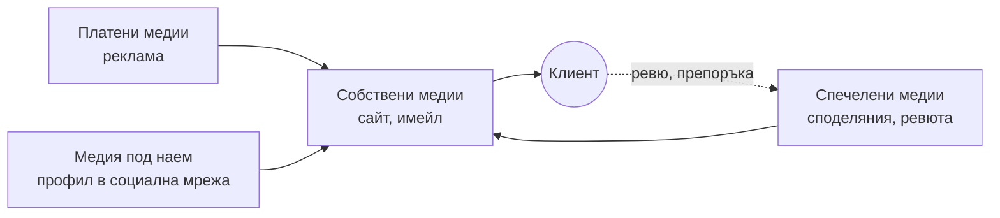
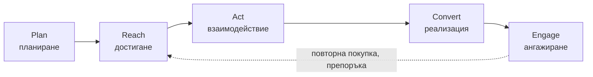

# Модул 01. Какво е дигитален маркетинг днес

## Цели на урока

След този урок ученикът може да:

* обясни разликата между дигитален маркетинг и „правене на социални мрежи“;
* разпознае трите вида медии: платени, собствени и спечелени;
* опише пътя на клиента в дигитална среда с рамката RACE;
* даде пример от български бизнес за всеки от тези елементи.

## 1. Да започнем с един въпрос

Една сладкарница в Пловдив има 12 000 последователи в Instagram. Друга има 900 последователи, но продава три пъти повече торти по поръчка. Коя от двете прави по-добър дигитален маркетинг?

Отговорът е: не знаем, докато не видим какво се случва след харесването. Дигиталният маркетинг не е броят последователи. Това е използването на дигитални технологии, за да постигнеш маркетингови цели: да те намерят, да ти повярват, да купят и да се върнат.

> **Опитай сам.** Отвори Instagram профилите на две сладкарници или пекарни от твоя град. Запиши за всяка колко последователи има и дали в профила има линк за поръчка, телефон или меню с цени. Коя от двете ти улеснява покупката повече?

## 2. Определение, което да запомните

**Digital marketing (дигитален маркетинг)** е постигането на маркетингови цели чрез дигитални медии, данни и технологии.

Обърнете внимание на трите думи:

* **медии** са каналите: сайт, търсачки, социални мрежи, имейл, приложения, маркетплейси;
* **данни** са информацията, която събираме за поведението на клиентите и която ни помага да решаваме;
* **технологии** са инструментите: от Google Analytics до системите за автоматизация и изкуствения интелект.

Ако една фирма има профил във Facebook, но не знае колко поръчки идват оттам, тя присъства онлайн, но още не прави дигитален маркетинг.

> **Опитай сам.** Вземи едно изречение от определението и го приложи към Ozone.bg: какви медии ползва (посети сайта и профилите им), какви данни вероятно събира при поръчка и какви технологии виждаш (чат, препоръки, проследяване на пратка)?

## 3. Как изглежда България онлайн през 2026

Няколко числа, с които да започнем разговора в клас:

* според НСИ през 2025 г. 92,8% от домакинствата имат достъп до интернет, а 86,5% от хората между 16 и 74 години го ползват поне веднъж седмично;
* смартфонът е най-използваното устройство за достъп до интернет (85,5%), далеч пред лаптопа (34,5%);
* по данни на DataReportal в България има около 4,8 млн. потребителски профила в социалните мрежи, което е малко над 72% от населението;
* Българската Е-комерс асоциация отчита, че през 2025 г. плащането с карта за първи път изпреварва наложения платеж, а над две трети от онлайн поръчките се получават извън дома, в офис на куриер или в автомат.

**Какво следва от това за маркетолога?** Мислим първо за телефона. Клиентът вече не се страхува толкова да плати онлайн. Доставката до автомат на Box Now или до офис на Еконт е част от преживяването и трябва да се вижда още на продуктовата страница.

> **Опитай сам.** Анкетирай петима души от семейството си: на какво устройство пазаруват онлайн, как плащат и къде получават пратките (адрес, офис на Еконт или Спиди, автомат на Box Now). Сравни отговорите с числата от урока.

## 4. Трите вида медии

Най-полезната карта за начинаещ маркетолог е разделянето на медиите на три групи.

| Вид | На английски | Какво е | Български пример |
|---|---|---|---|
| Платени | Paid media (платени медии) | Плащаш, за да те видят | Реклама в Google, рекламна кампания в Instagram, позиция на продукт в eMAG |
| Собствени | Owned media (собствени медии) | Принадлежат на теб | Сайтът, имейл списъкът, мобилното приложение, блогът |
| Спечелени | Earned media (спечелени медии) | Други говорят за теб | Ревю в Google, споделяне, статия в медия, препоръка от инфлуенсър без заплащане |

Профилът ти в социална мрежа е нещо по средата. Ти го управляваш, но платформата определя правилата и кой го вижда. Затова казваме, че там си „под наем“. Опитният маркетолог винаги се опитва да прехвърли хората от наетата земя към собствената: от последовател към абонат на имейл, от абонат към клиент в собствения магазин.

### Пример

Малка винарна край Мелник пуска видео в TikTok за гроздобера. Видеото се споделя 3 000 пъти (спечелена медия). В профила има линк към сайта, където срещу абонамент получаваш покана за дегустация (собствена медия). След това винарната пуска реклама само към хората, които са гледали видеото докрай (платена медия). Трите вида работят заедно.

> **Опитай сам.** Избери Lidl България. Намери по един пример за платена медия (реклама, която виждаш онлайн), собствена медия (сайт, приложение Lidl Plus) и спечелена медия (статия, видео или ревю, написано от някой друг). Запиши линковете.

## 5. Рамката RACE: пътят на клиента

Удобен начин да подредим всички дейности е рамката RACE. Името идва от четирите етапа:

1. **Reach (достигане).** Хората научават, че съществуваш. Тук работят SEO, рекламата, социалните мрежи, PR.
2. **Act (взаимодействие).** Посетителят прави първа крачка: разглежда продукти, чете статия, абонира се. Целта е да го задържиш.
3. **Convert (реализация).** Покупка, запитване, записване за час.
4. **Engage (ангажиране).** Клиентът се връща, препоръчва те, пише ревю.

Преди тях има и етап **Plan (планиране)**, затова понякога ще видите съкращението PRACE.

### Защо това е важно

Повечето малки фирми в България хвърлят всичките си усилия в Reach. Правят публикации, пускат реклами, гонят харесвания. Но ако сайтът зарежда бавно на телефон, клиентът си тръгва в етап Act. Ако няма удобно плащане, губиш го в Convert. Ако след покупката никой не му пише, никога не стига до Engage.

> **Опитай сам.** Направи си поръчка на ужким в eMAG до последната стъпка преди плащането. Запиши кои елементи на сайта работят за всеки етап от RACE: какво те задържа (Act), какво те подтиква да купиш (Convert) и какво те кара да се върнеш (Engage).

## 6. Дигиталният маркетинг като професия

В обявите за работа ще срещнете тези роли:

* **Digital marketing specialist (специалист дигитален маркетинг)** управлява кампании в няколко канала;
* **Performance marketer (маркетолог с фокус върху резултатите)** работи с рекламни бюджети и мери всяко евро;
* **SEO specialist (специалист по оптимизация за търсачки)**;
* **Content marketer (маркетолог на съдържание)**;
* **Social media manager (мениджър социални мрежи)**;
* **CRM / email marketing specialist (специалист по взаимоотношения с клиенти и имейл маркетинг)**;
* **Marketing analyst (маркетингов анализатор)**.

Във всички тях има общо: умение да поставиш цел, да избереш канал, да измериш и да промениш.

> **Опитай сам.** Намери в jobs.bg, zaplata.bg или LinkedIn три обяви за работа в дигиталния маркетинг в България. Подчертай уменията, които се повтарят. Кои от тях вече имаш и кои искаш да развиеш до края на годината?

## 7. Пет мита, които ще разбием в курса

1. „Ако нещо е безплатно, като Instagram, значи не струва пари.“ Струва време, а времето е най-скъпият ресурс на малкия бизнес.
2. „Повече последователи значи повече продажби.“ Не непременно.
3. „SEO е мъртво, защото има AI.“ Хората и AI асистентите продължават да търсят информация, и двете се учат от сайтове.
4. „Рекламата в Google е само за големите.“ Местна фирма може да започне с 5 евро на ден.
5. „Маркетингът е креатив.“ Креативът е половината. Другата половина са числа.

> **Опитай сам.** Избери един от петте мита и намери реален български пример, който го опровергава. Например малка фирма, която продава добре с малко последователи. Подготви 1 минута устно представяне за класа.

## Въпроси за дискусия

1. Избери любим местен бизнес. Опиши кои от трите вида медии използва и коя му липсва.
2. Последната ти онлайн покупка: на кой етап от RACE почти се отказа и защо?
3. Ако имаш 300 евро месечно за маркетинг на нова кафе точка в твоя квартал, къде би ги вложил първо?

## Ключови термини

| Термин | Превод |
|---|---|
| Digital marketing | дигитален маркетинг |
| Paid / owned / earned media | платени / собствени / спечелени медии |
| Customer journey | път на клиента |
| Reach, Act, Convert, Engage | достигане, взаимодействие, реализация, ангажиране |
| Conversion | реализация (желано действие: покупка, запитване) |
| Touchpoint | точка на контакт |

## Източници на данните

* НСИ, Използване на ИКТ в домакинствата и от лицата, 2025.
* DataReportal, Digital 2027: Bulgaria (данни към октомври 2026).
* Българска Е-комерс асоциация, годишно проучване 2023 до 2025.
