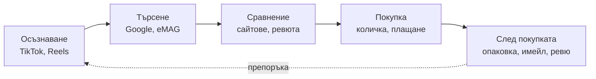

# Модул 02. Анализ на онлайн пазара

## Цели на урока

След този урок ученикът може да:

* анализира онлайн пазара на един бизнес през клиенти, конкуренти и посредници;
* начертае пътя на клиента и точките на контакт;
* разграничи директна продажба, маркетплейс и посредник;
* използва безплатни инструменти за първоначален анализ.

## 1. Защо анализът е преди кампанията

Представи си, че отваряш онлайн магазин за чай. Пускаш реклама и чакаш. Нищо. После разбираш, че хората търсят „билков чай за сън“, а ти рекламираш „премиум листен чай“. Че eMAG продава подобен чай с безплатна доставка. Че в Instagram три профила вече правят красиви ритуали с чай и имат лоялни последователи.

Всичко това можеше да научиш за един следобед. Анализът на онлайн пазара отговаря на три въпроса: **кой търси, кой още предлага и през кого минава продажбата.**

> **Опитай сам.** Помисли за последната си онлайн покупка. Кои три неща можеше да научиш предварително за продукта, цената и продавача, ако беше направил кратък анализ? Колко време би ти отнело?

## 2. Микросредата онлайн

Мислим за пет участника:

1. **Клиентите.** Какво търсят, на какви устройства, кога, какво ги спира.
2. **Конкурентите.** Директни (продават същото) и индиректни (решават същия проблем по друг начин). За пекарната индиректен конкурент е и Glovo, който доставя десерти от веригите.
3. **Посредниците.** Платформите между теб и клиента: eMAG, OLX, Booking, Glovo, Foodpanda, сравнителни сайтове като Pazaruvaj.com.
4. **Доставчиците и партньорите.** Куриери, платежни системи, платформи за магазини (Shopify, WooCommerce, CloudCart).
5. **Влиятелите.** Медии, блогъри, форуми, групи във Facebook, където хората питат „някой пробвал ли е…“.

> **Опитай сам.** Избери Glovo като посредник. Попълни за ресторант от твоя квартал петте участника в микросредата: клиенти, директни и индиректни конкуренти, посредници, партньори, влиятели.

## 3. Клиентът: от търсене до покупка

### Каналите, през които започва пътят

* **Търсачка.** Хората пишат проблема си: „болки в кръста стол“, „подарък за 18 рожден ден“.
* **Социални мрежи.** Тук често дори не търсят. Виждат и решават, че искат.
* **Маркетплейси.** Много българи започват търсенето на продукт директно в eMAG, особено за техника и дом.
* **AI асистенти.** Все повече хора питат ChatGPT, Gemini или Copilot „кой е добър…“. Отговорите се изграждат от съдържание в интернет, затова присъствието в добри източници е важно.
* **Препоръки.** Приятел, група във Facebook, ревю.

### Customer journey map (карта на пътя на клиента)

Карта, на която подреждаш стъпките на клиента, мислите и емоциите му и точките на контакт с марката.

| Етап | Какво прави клиентът | Какво мисли | Точка на контакт |
|---|---|---|---|
| Осъзнаване | Вижда видео как някой подрежда гардероб | „И моят е хаос“ | TikTok, Instagram Reels |
| Търсене | Пише „органайзер за гардероб“ | „Колко струва, ще пасне ли“ | Google, eMAG |
| Сравнение | Отваря три сайта | „Кой е най-надежден“ | Сайт, ревюта, цена с доставка |
| Покупка | Поръчва | „Дано пристигне бързо“ | Количка, плащане, избор на автомат |
| След покупката | Получава, ползва | „Струваше си“ или „разочарован съм“ | Опаковка, имейл, молба за ревю |

> **Опитай сам.** Начертай картата на пътя на клиента за ученик, който си търси нови слушалки. Използвай поне четири точки на контакт: TikTok или YouTube, Google, eMAG или Технополис, ревюта. Отбележи къде има най-голямо колебание.

## 4. Конкурентите: как да ги проучиш за един следобед

**Безплатни начини:**

* **Google търсене** на основните фрази. Кой е на първа страница органично и кой с реклама?
* **Meta Ad Library (библиотека на рекламите на Meta).** Показва всички активни реклами на всяка страница във Facebook и Instagram. Можеш да видиш какви оферти тества конкурентът.
* **Google Ads Transparency Center (център за прозрачност на рекламите в Google).** Същото за рекламите в Google и YouTube.
* **Google Trends.** Сезонност и сравнение на интерес между теми. Например кога в България се търси „мартеници на едро“ (подсказка: още от декември).
* **Ревютата на конкурентите.** Най-ценният източник. В оплакванията на клиентите им се крие твоята възможност.

### Рамка за сравнение

| Критерий | Ти | Конкурент А | Конкурент Б |
|---|---|---|---|
| Цена на основния продукт | | | |
| Цена и срок на доставка | | | |
| Методи на плащане | | | |
| Оценка в Google / брой ревюта | | | |
| Активни реклами (да/не, какви) | | | |
| Силно послание | | | |
| Слабост, която клиентите споменават | | | |

> **Опитай сам.** Отвори Meta Ad Library и потърси „Фантастико“ и „BILLA България“. Запиши какви оферти и формати рекламират в момента. После потърси в Google Trends „Black Friday“ за България и виж кога започва интересът.

## 5. Посредниците: да продаваш сам или през платформа

| Модел | Предимства | Рискове | Пример |
|---|---|---|---|
| Собствен онлайн магазин | Контрол, данни за клиентите, по-голям марж | Трябва ти трафик, доверие | Малка марка козметика на Shopify |
| Marketplace (онлайн пазар) | Готов трафик, доверие в платформата | Комисиона, ценова война, клиентът е на платформата | Продавач в eMAG Marketplace |
| Посредник за услуги | Видимост, резервации | Комисиона, зависимост | Хотел в Booking, ресторант в Glovo |
| Обяви | Бърз старт, евтино | Слаб имидж, ниска цена | OLX, Bazar.bg |

Умната стратегия обикновено е комбинация. Ресторант продава през Glovo, за да стигне до нови клиенти, но в кутията слага картичка с код за отстъпка при директна поръчка. Това е **disintermediation (заобикаляне на посредника)** по честен начин.

Обратният процес, **reintermediation (поява на нови посредници)**, също се случва. Преди хотелите говореха директно с туристическите агенции. После дойде Booking. Сега идват AI асистентите, които може да станат следващият посредник.

> **Опитай сам.** Сравни как една и съща категория (например книги) се продава през Хеликон (собствен онлайн магазин), eMAG Marketplace и OLX. Кое е предимството на всеки канал за купувача и за продавача?

## 6. Бизнес модели онлайн

* **B2C (бизнес към потребител):** онлайн магазин за дрехи.
* **B2B (бизнес към бизнес):** доставчик на опаковки за ресторанти.
* **C2C (потребител към потребител):** Vinted, OLX.
* **D2C, direct to consumer (директно към потребителя):** производител, който прескача търговците. Например българска марка бельо, която продава само от сайта си.
* **Subscription (абонамент):** кутия с кафе всеки месец.

> **Опитай сам.** Определи бизнес модела на пет компании: Vinted, SoftUni, Kaufland, Revolut и Booking.com. Кои са B2C, B2B, C2C, D2C или абонаментни? Има ли компания, която попада в повече от една група?

## 7. Инструменти за проучване на ауdиторията

Подбрани инструменти, които препоръчвам на учениците си. Към всеки пише какво прави и дали има безплатен план. Цените и условията се променят, затова проверявай на сайта на инструмента, преди да въвеждаш данни, и внимавай с възрастовите ограничения.

Преди да създадете съдържание, разберете какво интересува хората. Тези инструменти ви показват реалните им въпроси и поведение.

* **[Google Trends](https://trends.google.com/)** (безплатен). Показва колко се търси дадена тема в Google във времето и по държави. Изберете България и сравнете например „подарък за мама“ и „цветя“ преди 8 март.
* **[AnswerSocrates](https://answersocrates.com/)** (безплатен). Пишете тема и виждате въпросите, които хората задават за нея в Google. Всеки въпрос е идея за публикация или статия.
* **[Reddit](https://www.reddit.com/)** (безплатен). Огромен форум, разделен на общности по теми. Прочетете как хората говорят за даден продукт със свои думи и ще пишете по-добри текстове.
* **[Microsoft Clarity](https://clarity.microsoft.com/)** (безплатен). Поставяте кратък код на сайта и виждате къде кликат посетителите, докъде скролват и къде се отказват. Започнете с него.
* **[Hotjar](https://www.hotjar.com/)** (безплатен план). Прави същото като Clarity и добавя анкети и въпроси към посетителите.

> **Опитай сам.** Избери продукт на бизнеса от твоя проект. В Google Trends сравни две думи, с които хората го търсят в България, а в AnswerSocrates запиши 5 въпроса, които задават. Кой въпрос би превърнал в публикация?

Пълният каталог с инструменти за маркетинг и AI е тук: [Основни инструменти за маркетинг и изкуствен интелект](https://github.com/kikiaangelova/marketing-ai-resources/blob/main/marketing-ai-instrumenti.md).

## Въпроси за дискусия

1. Кой е последният продукт, който купи, след като го видя в социална мрежа, без да си го търсил? Нарисувай пътя си.
2. Ако продаваш ръчно изработени свещи, би ли започнал от Etsy, eMAG, собствен магазин или Instagram? Защо?
3. Как AI асистентите могат да променят ролята на сравнителните сайтове?

## Ключови термини

| Термин | Превод |
|---|---|
| Marketplace | онлайн пазар, платформа с много продавачи |
| Intermediary | посредник |
| Disintermediation | заобикаляне на посредника |
| Reintermediation | поява на нов посредник |
| Customer journey map | карта на пътя на клиента |
| Competitor benchmarking | сравнителен анализ на конкурентите |
| Search intent | намерение зад търсенето |
