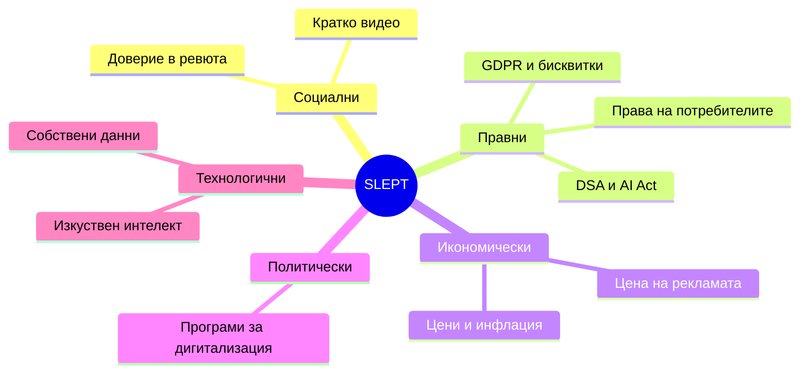

# Модул 03. Макросредата: закони, технологии, общество

## Цели на урока

След този урок ученикът може да:

* анализира външните фактори около дигиталния бизнес с рамката SLEPT;
* назове основните закони, които засягат дигиталния маркетинг в България и ЕС;
* разпознае законово рискова маркетингова практика;
* обясни как технологичните промени създават нови възможности.

## 1. Какво не зависи от нас

Микросредата (модул 02) са участниците, с които общуваме всеки ден. Макросредата са големите сили, които не можем да контролираме, но трябва да следим: закони, икономика, технологии, общество, политика.

Удобна рамка е **SLEPT**:

* **S**ocial (социални фактори)
* **L**egal (правни фактори)
* **E**conomic (икономически фактори)
* **P**olitical (политически фактори)
* **T**echnological (технологични фактори)

Ще срещнете и PESTEL: същите пет групи, подредени по друг начин, плюс шеста, Environmental (екологични фактори). SLEPT поставя правото напред нарочно, защото в дигиталния маркетинг то променя играта най-често.

> **Опитай сам.** Направи бърз SLEPT анализ за Bolt в София: по едно изречение за всяка буква. Кой фактор според теб е най-голямото предизвикателство за компанията?

## 2. Правна среда: какво трябва да знае всеки маркетолог

### 2.1. Лични данни и GDPR

**GDPR (Общ регламент относно защитата на данните)** важи в целия ЕС от 2018 г. В България контролният орган е Комисията за защита на личните данни (КЗЛД).

Шест неща, които маркетологът трябва да помни:

1. Събираш само данните, които ти трябват. За бюлетин стига имейл, не ти трябва ЕГН и адрес.
2. Трябва ти правно основание. За маркетингови имейли обикновено това е **consent (съгласие)**, което е активно и свободно. Предварително сложена отметка не е съгласие.
3. Казваш ясно за какво ще ползваш данните.
4. Човекът може да се откаже по всяко време, и то лесно. Линк „отпиши се“ във всеки имейл.
5. Човекът има право да види данните си и да поиска изтриването им.
6. Пазиш данните сигурно. Таблица с клиенти, споделена с „всеки с линка“, е нарушение.

### 2.2. Бисквитки

Бисквитките (cookies) за реклама и анализ изискват съгласие, преди да бъдат заредени. Банерът трябва да дава реален избор: бутоните „Приемам“ и „Отказвам“ трябва да са еднакво лесни. Ако откажеш, сайтът трябва да работи.

За рекламите в Google в ЕС вече е задължителен **Consent Mode (режим на съгласие)**: сайтът казва на Google дали посетителят е дал съгласие и Google съобразява измерването с това.

### 2.3. Права на потребителите

* **Право на отказ:** при онлайн покупка клиентът има 14 дни да върне стоката без причина (Закон за защита на потребителите, с някои изключения, например стоки по поръчка).
* **Намаления:** когато обявяваш намаление, като стара цена се посочва най-ниската цена през последните 30 дни. „Black Friday“ с изкуствено вдигната предварително цена е нарушение.
* **Еврото:** от 1 януари 2026 г. цените в България са в евро. Периодът на двойното обозначаване в лева и евро продължи до август 2026 г. Внимавайте със стари банери и шаблони, в които още стоят само левове.
* **Ревюта:** ако показваш ревюта, трябва да кажеш как проверяваш, че са от реални клиенти. Фалшивите ревюта са забранени.

### 2.4. Платформите и Законът за цифровите услуги

**DSA, Digital Services Act (Акт за цифровите услуги)** задължава големите платформи да са прозрачни: защо ти се показва дадена реклама, кой я плаща. Забранява и рекламата, насочена към непълнолетни въз основа на профилиране, както и таргетирането по чувствителни данни като религия или здраве. За маркетолога това значи по-малко опции за таргетиране и повече зависимост от собствени данни.

### 2.5. Инфлуенсъри и скрита реклама

Платеното съдържание трябва да е обозначено ясно: „Реклама“, „Платено партньорство“. Подаръкът също е заплащане. В България насоки дава Националният съвет за саморегулация, а на ниво ЕС Комисията редовно проверява инфлуенсъри за скрита реклама.

### 2.6. Достъпност

От юни 2025 г. Европейският акт за достъпност изисква много онлайн магазини и услуги да са достъпни за хора с увреждания: текстови описания на снимките, достатъчен контраст, работа с клавиатура. Това не е само задължение, а и по-широк пазар.

### 2.7. Изкуственият интелект

**AI Act (Акт за изкуствения интелект)** на ЕС влиза в сила на етапи. За маркетинга най-важното е прозрачността: съдържание, генерирано или променено с AI, което може да заблуди (например реалистично видео на човек), трябва да бъде обозначено. Чатбот трябва да казва, че е бот.

### 2.8. Марки и авторски права

Не можеш да ползваш чужда марка в рекламата си, за да заблудиш, че си тях. Снимка от Google не е безплатна снимка. Музиката в Reels за бизнес профили също има лицензи.

> **Опитай сам.** Отвори сайтовете на Технополис и dm България. Сравни банерите за бисквитки: има ли бутон за отказ на първия екран, колко лесно е да откажеш? Снимай екраните и оцени кой е по-честен към потребителя.

## 3. Икономическа среда

* Инфлацията и поскъпването променят поведението: хората сравняват повече, търсят промоции, отлагат големи покупки.
* Преминаването към еврото накара много клиенти да следят цените по-внимателно. Прозрачната цена с доставка печели доверие.
* Цената на рекламата расте, когато много фирми се борят за една и съща аудитория (Коледа, Black Friday). Малкият бизнес печели, ако започне по-рано или избере по-тесни ниши.

> **Опитай сам.** Намери промоция в сайта на голям търговец (например Jumbo или Технополис). Посочена ли е предишната цена? Как би проверил дали тя наистина е най-ниската за последните 30 дни?

## 4. Социална среда

* Хората прекарват време в кратко видео. Вниманието е скъпо.
* Расте недоверието към рекламата и доверието в „хора като мен“: ревюта, реални клиенти, UGC (съдържание, създадено от потребителите).
* Поколението Z очаква марките да имат позиция, но наказва фалшивата позиция.
* Цифровото разделение: по данни на НСИ разликата в достъпа до интернет между градовете и селата намалява, но още съществува. Кампания, насочена към възрастни хора в малки населени места, не бива да разчита само на TikTok.

> **Опитай сам.** Разгледай профилите на две български марки, които правят кампании с млади хора (например Devin или Vivacom). Как показват, че разбират поколението Z? Има ли нещо, което според теб звучи фалшиво?

## 5. Политическа среда

Държавни и европейски програми за дигитализация на малки и средни предприятия, регулации на платформите, данъчни правила за онлайн търговци. Политическата нестабилност влияе на доверието и на решенията за покупка.

> **Опитай сам.** Потърси в сайта на Министерството на иновациите и дигиталната трансформация или на Българската агенция за инвестиции текуща програма за дигитализация на малкия бизнес. Как би обяснил на собственик на магазин за какво може да кандидатства?

## 6. Технологична среда

* **Изкуствен интелект** в търсенето, рекламата и създаването на съдържание (модул 12).
* **Бисквитките на трети страни губят сила.** Safari и Firefox ги блокират по подразбиране, а много хора отказват бисквитките в банера. През 2025 г. Google се отказа да ги спира в Chrome, но маркетологът вече не може да разчита на тях. Затова расте ролята на собствените данни (first-party data).
* **Гласово и визуално търсене:** снимаш продукт и телефонът ти намира къде се продава.
* **Нови начини на плащане и доставка:** Apple Pay, Google Pay, автомати за пратки.

Правило: не всяка нова технология заслужава твоя бюджет. Питай: ползва ли я моят клиент вече?

> **Опитай сам.** Снимай етикет или продукт с Google Lens и виж къде се продава и на каква цена. Какво означава това за малък магазин, който продава същия продукт? Запиши две идеи как може да се отличи.

## Въпроси за дискусия

1. Получавали ли сте имейл от фирма, на която никога не сте давали адреса си? Какво казва GDPR за това?
2. Кой банер за бисквитки сте виждали напоследък, който ви „натиска“ да приемете? Как е направен?
3. Ако инфлуенсър получи безплатна чанта и я покаже, трябва ли да напише „реклама“? Защо?

## Ключови термини

| Термин | Превод |
|---|---|
| SLEPT / PESTEL | рамки за анализ на макросредата |
| GDPR | Общ регламент относно защитата на данните |
| Consent | съгласие |
| Opt-in / opt-out | активно включване / отказване |
| First-party data | собствени данни, събрани от самата фирма |
| Dark patterns | манипулативни елементи в дизайна |
| DSA | Акт за цифровите услуги |
| AI Act | Акт за изкуствения интелект |
| Accessibility | достъпност |
