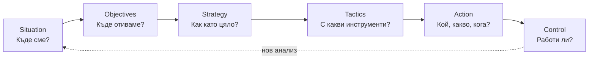
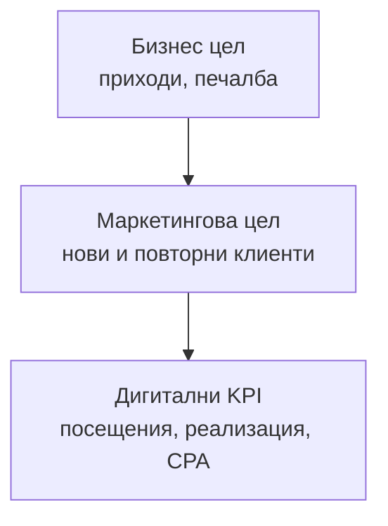

# Модул 04. Дигитална маркетингова стратегия

## Цели на урока

След този урок ученикът може да:

* построи стратегия по модела SOSTAC;
* формулира SMART цели и ги свърже с бизнес резултат;
* направи SWOT и да го превърне в решения чрез TOWS;
* напише онлайн ценностно предложение (OVP);
* разпредели бюджет между канали с аргументи.

## 1. Стратегия срещу тактика

„Ще пускаме три Reels седмично“ е тактика. „Ще станем първият избор за сватбени торти в Пловдив, като спечелим доверието на младоженците още в етапа на планиране“ е стратегия. Стратегията казва **къде отиваме и защо**. Тактиката казва **как точно**.

Типичната грешка на малкия бизнес е да започне от тактиката, защото е видима и бърза.

> **Опитай сам.** Напиши една стратегия и три тактики за твоето училище, ако то иска повече кандидати за 8. клас. Внимавай стратегията да казва къде отиваме и защо, а тактиките как точно.

## 2. Моделът SOSTAC

Създаден е от британския маркетолог PR Smith и е един от най-разпространените модели за маркетингов план. Шест стъпки:

| Стъпка | Въпрос | Какво съдържа |
|---|---|---|
| **S**ituation (ситуация) | Къде сме сега? | Резултати досега, клиенти, конкуренти, SWOT |
| **O**bjectives (цели) | Къде искаме да бъдем? | SMART цели |
| **S**trategy (стратегия) | Как ще стигнем дотам като цяло? | Сегменти, позициониране, OVP, избор на канали |
| **T**actics (тактики) | Кои са конкретните инструменти? | Канали, съдържание, календар, бюджет |
| **A**ction (действие) | Кой какво прави и кога? | Отговорници, срокове, процеси |
| **C**ontrol (контрол) | Как ще разберем дали работи? | KPI, отчети, честота на проверка |

> **Опитай сам.** Избери ски курорт Банско или Пампорово и опиши с по едно изречение какво би написал във всяка стъпка на SOSTAC за следващия зимен сезон.

## 3. Situation: SWOT и TOWS

**SWOT** описва силните страни (Strengths), слабостите (Weaknesses), възможностите (Opportunities) и заплахите (Threats).

SWOT сам по себе си е снимка. Ценността идва, когато го превърнеш в решения. За това служи **TOWS матрицата**:

| | Силни страни (S) | Слабости (W) |
|---|---|---|
| **Възможности (O)** | SO: използвай силата, за да хванеш възможността | WO: поправи слабостта чрез възможността |
| **Заплахи (T)** | ST: използвай силата, за да се защитиш | WT: намали слабостта и избегни заплахата |

### Пример: семеен хотел в Трявна

* S: автентична къща, домашна кухня, 4,9 в Google;
* W: няма собствен сайт за резервации, зависи от Booking;
* O: интерес към „slow travel“ и уикенди извън големите курорти;
* T: нови къщи за гости в района, по-високи комисиони.

Решения: **SO** кампания „уикенд за забавяне“ с реални ревюта на гости; **WO** собствена система за резервации с бонус (вечеря или късно напускане) при директна резервация; **ST** програма за завръщащи се гости; **WT** постепенно намаляване на дела на Booking от 80% на 60% за година.

> **Опитай сам.** Направи SWOT за Хеликон срещу онлайн магазините и Amazon. После изведи поне едно решение във всяко поле на TOWS.

## 4. Objectives: SMART цели

Целта трябва да е:

* **S**pecific (конкретна)
* **M**easurable (измерима)
* **A**chievable (постижима)
* **R**elevant (свързана с бизнеса)
* **T**ime-bound (със срок)

Слаба цел: „Повече продажби онлайн.“

SMART цел: „Да увеличим директните резервации през сайта от 20% на 35% от всички резервации до 31 октомври 2027 г.“

### Пирамида на целите

Свържи всяка маркетингова цел с бизнес цел:

1. **Бизнес цел:** приходи, печалба, пазарен дял.
2. **Маркетингова цел:** нови клиенти, повторни покупки, средна стойност на поръчката.
3. **Дигитални KPI (ключови показатели):** посещения, коефициент на реализация, цена за придобиване на клиент.

Ако не можеш да кажеш как харесванията водят до приходи, не ги слагай като главна цел.

> **Опитай сам.** Препиши тези три слаби цели като SMART: „Искаме повече клиенти“, „Да сме по-известни в Instagram“, „Да продаваме повече онлайн“. Свържи всяка с бизнес цел от пирамидата.

## 5. Strategy: сегментиране, таргетиране, позициониране

**Segmentation (сегментиране).** Разделяш пазара на групи с общи нужди. Онлайн можем да сегментираме и по поведение: нови посетители, посетители, които са разглеждали продукт, клиенти с една покупка, лоялни клиенти.

**Targeting (избор на целеви сегменти).** Избираш на кои групи ще се фокусираш. Малкият бизнес не може да бъде за всички.

**Positioning (позициониране).** Какво място искаш да заемеш в ума на клиента в сравнение с конкурентите.

**Persona (персона).** Описание на типичен клиент като човек: име, възраст, ден, цели, страхове, къде е онлайн. Пример: „Ива, 31 г., работи в IT в София, планира сватба след 10 месеца, търси вдъхновение в Pinterest и Instagram, страхува се, че тортата няма да изглежда като на снимката.“

### OVP, online value proposition (онлайн ценностно предложение)

Отговор на въпроса: **защо да избера теб онлайн, а не конкурента или магазина на ъгъла?** Трябва да се вижда в първите секунди на сайта и в рекламите.

Формула за начало: *За [кого], които [имат нужда], ние предлагаме [какво], което [ползата], за разлика от [алтернативата].*

Пример: „За заети родители в София, които нямат време за пазар, доставяме прясно българско месо и зеленчуци от ферми до вратата в рамките на 24 часа, с пълна информация от коя ферма идва всеки продукт.“

> **Опитай сам.** Напиши персона за типичен клиент на Sopharmacy и OVP за онлайн магазина ѝ по формулата от урока. Провери в сайта на Sopharmacy дали тяхното послание отговаря на твоето.

## 6. Избор на канали и бюджет

Никоя фирма не трябва да е навсякъде. Избираш по:

* къде е твоят клиент;
* на кой етап от RACE е най-голямата загуба;
* колко ресурс имаш (време, бюджет, хора, умения).

### Правилото 70/20/10

* 70% от бюджета за доказани канали;
* 20% за развиващи се канали с потенциал;
* 10% за експерименти.

### Пример: бюджет 1 000 евро месечно за онлайн магазин за домашни любимци

| Канал | Сума | Защо |
|---|---|---|
| Google Ads (търсене и Shopping) | 400 € | Хората търсят конкретна храна, намерението е високо |
| Meta реклами към посетители на сайта | 250 € | Връщане на хора, които са разглеждали |
| Имейл автоматизация (платформа) | 50 € | Напомняне за нова храна след 30 дни |
| Съдържание и SEO (статии за грижа) | 200 € | Дългосрочен органичен трафик |
| Експеримент: TikTok с ветеринар | 100 € | Тест на нов канал |

> **Опитай сам.** Имаш 500 евро месечно за нова книжарница-кафе във Велико Търново. Разпредели ги по правилото 70/20/10 и обясни избора си в 3 изречения.

## 7. Action и Control

Добрият план има отговорник за всяка дейност и дата за проверка. Контролът не е отчет в края на годината. Седмично гледаш оперативните числа (разход, кликове, поръчки), месечно стратегическите (нови клиенти, повторни покупки, цена за придобиване).

> **Опитай сам.** Начертай таблица с отговорници и срокове за една кампания за абитуриентски бал във фотостудио. Кой какво прави, до кога и какъв е показателят, по който проверяваме?

## 8. Ansoff: накъде да растем

| | Съществуващи продукти | Нови продукти |
|---|---|---|
| **Съществуващи пазари** | Проникване на пазара: повече продажби на същите клиенти | Развитие на продукта: нов продукт за същите клиенти |
| **Нови пазари** | Развитие на пазара: нова държава или нов сегмент | Диверсификация: нов продукт за нови клиенти |

Дигиталното позволява по-лесно развитие на пазара: един онлайн магазин може да продава в Румъния и Гърция със същия склад.

> **Опитай сам.** Посочи по един пример от България за всяка посока на Ансоф. Подсказка: помисли как eMAG, Еконт или Glovo са разширили дейността си през последните години, като провериш в сайтовете им.

## Въпроси за дискусия

1. Напиши OVP за училището си, сякаш привличаш нови ученици онлайн.
2. Каква SMART цел би поставил за училищен благотворителен базар?
3. Защо 10% експериментален бюджет е важен дори за малка фирма?

## Ключови термини

| Термин | Превод |
|---|---|
| SOSTAC | модел за маркетингов план |
| SWOT / TOWS | анализ на силни и слаби страни, възможности и заплахи / превръщането му в стратегии |
| SMART objectives | конкретни, измерими, постижими, свързани, срочни цели |
| KPI, key performance indicator | ключов показател за ефективност |
| Segmentation, targeting, positioning | сегментиране, таргетиране, позициониране |
| Persona | персона, образ на типичен клиент |
| OVP, online value proposition | онлайн ценностно предложение |
| Ansoff matrix | матрица на Ансоф за посоките на растеж |
