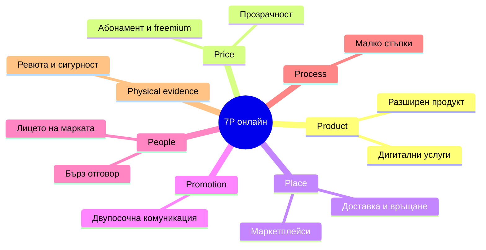

# Модул 05. Маркетинговият микс в дигитална среда

## Цели на урока

След този урок ученикът може да:

* приложи модела 7P към дигитален бизнес;
* обясни как интернет променя продукта, цената, дистрибуцията и комуникацията;
* сравни ценови модели онлайн (абонамент, freemium, динамична цена);
* предложи промени в микса за конкретна фирма.

## 1. От 4P към 7P

Класическият маркетингов микс има четири елемента: **Product (продукт), Price (цена), Place (място, дистрибуция), Promotion (промоция, комуникация)**. За услугите и за онлайн бизнеса добавяме още три: **People (хора), Process (процес), Physical evidence (физически доказателства)**.

Интернет не отменя миксa. Променя всеки от елементите.

## 2. Product: продуктът

### Основен и разширен продукт

* **Core product (основен продукт):** самото нещо. Тениската.
* **Extended product (разширен продукт):** всичко около него. Таблица с размери, видео как стои на модел, безплатна смяна на размера, ревюта, гаранция, опаковка.

Онлайн клиентът не може да пипне продукта, затова разширеният продукт често решава покупката.

### Дигитални продукти и услуги

* Изцяло дигитални: онлайн курс, шаблон за Canva, дигитален планер, приложение.
* Дигитални услуги към физически продукт: приложение към фитнес гривна, онлайн конфигуратор на кухня (както при IKEA), проследяване на пратка.

### Съвместно създаване

Интернет позволява клиентите да участват в продукта: гласуване за нов вкус, тестова група, предложения в коментарите. Малка българска марка за сладолед може да пита последователите си какъв вкус да е следващият сезонен.

## 3. Price: цената

### Какво се промени

* **Прозрачност:** всеки сравнява за секунди през Pazaruvaj.com, Google Shopping или eMAG.
* **Натиск надолу:** при еднакви продукти печели най-ниската цена. Затова малките търговци трябва да се отличават другаде.
* **Цената с доставката:** клиентът гледа крайната сума. „Безплатна доставка над 40 евро“ често работи по-добре от отстъпка.

### Ценови модели онлайн

| Модел | Как работи | Пример |
|---|---|---|
| Subscription (абонамент) | Месечно или годишно плащане | Кутия с кафе всеки месец, Spotify |
| Freemium (безплатно с платени функции) | Основното е безплатно, разширеното се плаща | Canva, приложения за учене |
| Dynamic pricing (динамично ценообразуване) | Цената се мени според търсенето | Самолетни билети, хотели, Bolt |
| Bundling (пакет) | Няколко продукта заедно с отстъпка | Комплект козметика за подарък |
| Pay what you want (плати колкото искаш) | Клиентът избира цената | Благотворителни продажби, някои онлайн материали |

### Психология на цената

* 19,90 € изглежда по-малко от 20 €.
* Котва: първо показваш по-скъпия вариант, после стандартния изглежда разумен.
* Три пакета (базов, стандартен, премиум): повечето хора избират средния.

## 4. Place: дистрибуцията

* **Къде купува клиентът:** собствен сайт, маркетплейс, социална мрежа, приложение, физически магазин.
* **Omnichannel (многоканалност):** клиентът започва онлайн и завършва в магазина или обратното. „Поръчай онлайн, вземи от магазина“ е пример.
* **Доставката е част от продукта:** избор между Еконт, Спиди, Box Now, доставка до адрес, срок, проследяване, лесно връщане.
* **Channel conflict (конфликт между канали):** ако производител продава на по-ниска цена в собствения си сайт, търговците му се сърдят. Решения: различни пакети, ексклузивни продукти за всеки канал.

## 5. Promotion: комуникацията

Онлайн комуникацията е двупосочна. Марката не само говори, а и слуша и отговаря. Основните инструменти разглеждаме подробно в модули 08 до 10: търсачки, реклама, съдържание, социални мрежи, имейл, партньорства, PR.

Важното за микса: посланието трябва да е еднакво във всички канали. Ако в рекламата обещаваш „доставка за 24 часа“, а на сайта пише „3 до 5 работни дни“, губиш доверие.

## 6. People: хората

* Кой отговаря в чата и колко бързо;
* какъв е тонът в коментарите;
* има ли реален човек зад марката (основателят, екипът).

За малкия бизнес хората са най-голямото предимство пред големите. Видео на собственичката на цветарница, която обяснява как да запазиш букета свеж, изгражда повече доверие от професионална реклама.

## 7. Process: процесът

Колко стъпки са нужни, за да купиш? Регистрацията задължителна ли е? Има ли потвърждение по имейл? Какво става при връщане? Онлайн процесът е видим и сравним, затова всяка излишна стъпка струва продажби.

## 8. Physical evidence: доказателствата

Онлайн „физическите доказателства“ са сигналите за доверие:

* дизайнът и скоростта на сайта;
* ревюта и рейтинги;
* сертификати, сигурно плащане, данни за фирмата (ЕИК, адрес, телефон);
* снимки на екипа и мястото;
* опаковката, когато пратката пристигне.

## 9. Пример: целият микс за една фирма

**Фирма:** „Зелена кошница“, доставка на био зеленчуци от ферми около Пловдив.

| P | Решение |
|---|---|
| Product | Седмична кошница в 3 размера, рецепти към всяка кошница, информация от коя ферма е всеки продукт |
| Price | Абонамент с 10% отстъпка спрямо единична поръчка, безплатна доставка за абонати |
| Place | Собствен сайт, доставка в Пловдив до врата, извън града до автомат |
| Promotion | Видео от фермите, имейл с рецепти, партньорство с местни кулинарни блогъри |
| People | Фермерите са лицето на марката, отговор в чата до 1 час |
| Process | Поръчка за 2 минути, пауза на абонамента с един клик |
| Physical evidence | Снимки от фермите, ревюта, хартиена опаковка с бележка от фермера |

## Въпроси за дискусия

1. Кой онлайн магазин ви е спечелил заради разширения продукт, а не заради цената?
2. Защо според вас много приложения минават от еднократно плащане към абонамент?
3. Какъв конфликт между канали може да има марка дрехи, която продава и в мол, и онлайн?

## Ключови термини

| Термин | Превод |
|---|---|
| Marketing mix, 7P | маркетингов микс, 7 елемента |
| Core / extended product | основен / разширен продукт |
| Price transparency | ценова прозрачност |
| Subscription, freemium, dynamic pricing | абонамент, безплатно с платени функции, динамично ценообразуване |
| Omnichannel | многоканалност, свързано преживяване между каналите |
| Channel conflict | конфликт между каналите |
| Trust signals | сигнали за доверие |
