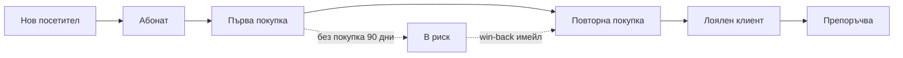
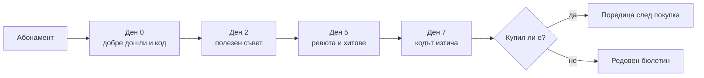

# Модул 06. Взаимоотношения с клиентите и CRM

## Цели на урока

След този урок ученикът може да:

* обясни защо задържането на клиент е по-изгодно от привличането на нов;
* изчисли стойността на клиента във времето (CLV);
* сегментира клиенти с модела RFM;
* планира автоматизирана имейл поредица;
* разграничи лоялност от навик и от отстъпка.

## 1. Защо старият клиент е злато

Привличането на нов клиент струва реклама, време, доверие. Клиентът, който вече е купил веднъж, ти вярва. Ако му продадеш втори път, разходът е много по-малък.

Пример: онлайн магазин за козметика плаща средно 18 € реклама, за да привлече нов клиент. Средната поръчка е 35 €, а печалбата от нея е 12 €. Първата покупка е на загуба! Магазинът печели само ако клиентът се върне.

> **Опитай сам.** Помисли за магазин, от който купуваш редовно. Защо се връщаш? Запиши три причини и провери дали магазинът прави нещо нарочно, за да се върнеш.

## 2. CLV, customer lifetime value (стойност на клиента във времето)

Опростена формула:

**CLV = средна стойност на поръчката × брой покупки годишно × години, в които остава клиент × марж на печалбата**

Пример: 35 € × 4 покупки × 2 години × 35% марж = **98 € печалба** от един клиент.

Ако знаеш, че клиентът ти носи 98 € печалба, можеш спокойно да платиш 18 € за привличането му. Ако мислиш само за първата поръчка, ще спреш рекламата и ще загубиш растежа.

Свързан показател: **CAC, customer acquisition cost (цена за придобиване на клиент)**. Здравословно съотношение е CLV поне три пъти по-голямо от CAC.

> **Опитай сам.** Изчисли CLV за абонат на кутия с кафе: 22 евро на месец, остава средно 8 месеца, марж 30%. Колко най-много би платил за реклама, за да спечелиш един такъв абонат?

## 3. CRM: какво е и какво не е

**CRM, customer relationship management (управление на взаимоотношенията с клиентите)** е едновременно подход и софтуер.

* **Подходът:** познаваш клиентите си и им говориш според това кои са и какво са правили.
* **Софтуерът:** система, в която пазиш контакти, покупки, разговори и автоматизации. Примери: HubSpot, Brevo, Klaviyo, Mailchimp, Pipedrive, а за по-големи Salesforce.

CRM не е списък с имейли, на който пращаш едно и също на всички.

> **Опитай сам.** Регистрирай се в програмата за лоялност на веригата, която семейството ти ползва най-много (например Lidl Plus, Kaufland Card или BILLA). Какви данни събира и какво ти дава в замяна?

## 4. Сегментиране на клиентите: RFM

**RFM** оценява всеки клиент по три въпроса:

* **R**ecency (давност): колко скоро е купил последно?
* **F**requency (честота): колко пъти е купувал?
* **M**onetary (стойност): колко е похарчил общо?

| Сегмент | Описание | Какво правим |
|---|---|---|
| Шампиони | Купуват често, наскоро, харчат много | Ранен достъп, VIP отношение, молба за ревю и препоръка |
| Лоялни | Купуват редовно | Програма за лоялност, кръстосани продажби |
| Нови | Една скорошна покупка | Посрещане, съвети за ползване, стимул за втора покупка |
| В риск | Купуваха често, но отдавна не са | Лично съобщение, „липсвате ни“, анкета защо |
| Изгубени | Една покупка преди много време | Последен опит, после спираме да харчим за тях |

> **Опитай сам.** Раздели десет измислени клиенти на сладкарница по RFM (измисли им давност, честота и сума). Кои двама ще получат лично съобщение тази седмица и какво ще им напишеш?

## 5. Имейл маркетинг: собствената медия номер едно

Имейлът звучи старомодно, но е канал, който притежаваш, евтин и измерим. Работи, ако е полезен и персонален.

### Видове имейли

* **Бюлетин (newsletter):** редовен, със съдържание и оферти.
* **Транзакционни:** потвърждение, пратка, фактура. Отварят се най-много, затова са място и за полезна информация.
* **Автоматизирани (тригерни):** изпращат се, когато клиентът направи нещо или не направи нещо.

### Основни автоматизации

| Автоматизация | Кога се изпраща | Цел |
|---|---|---|
| Welcome series (поредица за посрещане) | След абонамент | Запознаване с марката, първа покупка |
| Abandoned cart (изоставена количка) | 1 час и 24 часа след оставена количка | Връщане към покупката |
| Post-purchase (след покупка) | След доставка | Съвети за ползване, молба за ревю |
| Replenishment (напомняне за ново зареждане) | Когато продуктът свършва | Повторна покупка |
| Win-back (връщане) | 90 дни без покупка | Връщане на клиента |
| Рожден ден | На рождения ден | Емоция и лоялност |

### Пример: поредица за посрещане на магазин за чай

1. **Веднага:** „Добре дошли. Ето как избираме чая си“ плюс код за 10% за първа поръчка.
2. **След 2 дни:** „Три грешки при запарването на зелен чай“ (полезно съдържание, без продажба).
3. **След 5 дни:** „Най-обичаните ни чайове“ с ревюта на клиенти.
4. **След 7 дни:** „Кодът ти изтича утре.“

### Показатели

* **Open rate (процент отворени):** вече е неточен, защото някои приложения отварят автоматично. Гледаме го като ориентир.
* **CTR, click-through rate (процент кликнали):** по-надежден.
* **Conversion rate (процент на реализация):** колко са купили.
* **Unsubscribe rate (процент отписали се):** ако расте, пращаш твърде често или неинтересно.

> **Опитай сам.** Абонирай се за бюлетина на български онлайн магазин и наблюдавай седмица какво ти изпраща. Има ли поредица за посрещане? Какво би подобрил?

## 6. Други канали за връзка

* **Viber и WhatsApp общности:** в България Viber е много разпространен. Подходящ за местни бизнеси, но с внимание да не досаждаш.
* **SMS:** за важни и кратки съобщения.
* **Push известия в приложение.**
* **Затворени групи във Facebook:** общност около марката.

> **Опитай сам.** Напиши съобщение за Viber общността на фитнес зала в твоя град за нови часове през ваканцията. До 300 знака, с ясен призив и без да звучи като спам.

## 7. Програми за лоялност

Добрата програма за лоялност дава причина да се върнеш, която не е само отстъпка.

* **Точки:** събираш и харчиш (например при веригите бензиностанции и аптеки).
* **Нива:** колкото повече купуваш, толкова повече привилегии.
* **Платено членство:** плащаш годишна такса за безплатна доставка и отстъпки.
* **Ценности и общност:** достъп до събития, участие в решения на марката.

Внимание: ако клиентът купува само когато има намаление, ти си го научил да чака намаления.

> **Опитай сам.** Сравни две програми за лоялност: на верига аптеки (например Sopharmacy или Remedium) и на верига бензиностанции. С какво те задържат? Има ли нещо освен отстъпки?

## 8. Персонализация

Персонализацията е повече от „Здравей, Иване“. Това са препоръки според предишни покупки, съдържание според интересите, оферти според сегмента. Границата е там, където клиентът се чувства наблюдаван. Ползвай данните, за които човекът знае и е съгласен.

> **Опитай сам.** Опиши една персонализация, която ти е харесала, и една, която те е подразнила. Къде е границата за теб?

## 9. Инструменти за имейл маркетинг и CRM

Подбрани инструменти, които препоръчвам на учениците си. Към всеки пише какво прави и дали има безплатен план. Цените и условията се променят, затова проверявай на сайта на инструмента, преди да въвеждаш данни, и внимавай с възрастовите ограничения.

Имейл маркетингът е изпращане на писма до хора, които сами са се абонирали. CRM (управление на взаимоотношенията с клиенти) пази кой е клиентът и какво сте си казали с него. Изпращайте писма само на хора, които са дали съгласие, така изисква и законът (GDPR, общият регламент за защита на данните).

* **[Brevo](https://www.brevo.com/)** (безплатен план). Най-простата платформа за изпращане на бюлетини и автоматични имейли. Добър първи избор за проект на ученическа фирма.
* **[Beehiiv](https://www.beehiiv.com/)** (безплатен план). Платформа, създадена специално за бюлетини, с инструменти за растеж на абонатите.
* **[Milled](https://milled.com/)** (безплатен). Търсачка за маркетингови имейли на големи брандове. Вижте как пишат и какво предлагат, преди да напишете свой.
* **[Bonjoro](https://www.bonjoro.com/)** (платен, с пробен период). Изпращате кратко лично видео на всеки нов клиент. Създава усещане за грижа.
* **[Manyreach](https://www.manyreach.com/)** (платен). Платформа за cold email outreach (студени имейли до непознати контакти). Внимание: в Европа писма до хора, които не са ви дали съгласие, са силно ограничени от GDPR.

> **Опитай сам.** В Milled намери приветствен имейл на бранд, който харесваш. Запиши темата, първото изречение и призива към действие. Какво би взел/а за бюлетина на своя бизнес?

Пълният каталог с инструменти за маркетинг и AI е тук: [Основни инструменти за маркетинг и изкуствен интелект](https://github.com/kikiaangelova/marketing-ai-resources/blob/main/marketing-ai-instrumenti.md).

## Въпроси за дискусия

1. Кой магазин ви пише имейли, които наистина отваряте? Защо?
2. Каква автоматизация би помогнала на фризьорски салон?
3. Къде е границата между полезна персонализация и „страшно е колко знаят за мен“?

## Ключови термини

| Термин | Превод |
|---|---|
| CRM | управление на взаимоотношенията с клиентите |
| CLV, customer lifetime value | стойност на клиента във времето |
| CAC, customer acquisition cost | цена за придобиване на клиент |
| Retention | задържане на клиентите |
| Churn | отлив на клиенти |
| RFM | давност, честота, стойност |
| Marketing automation | маркетингова автоматизация |
| Abandoned cart | изоставена количка |
| Loyalty program | програма за лоялност |
| Personalisation | персонализация |
