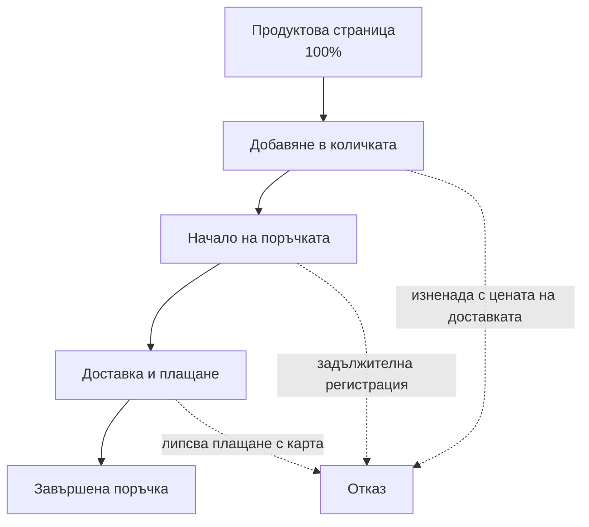
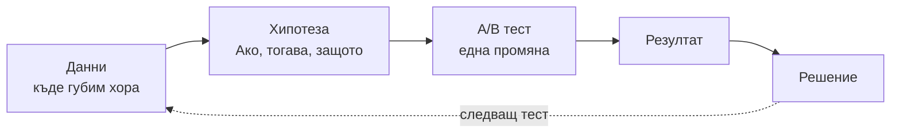

# Модул 07. Уебсайтът и клиентското преживяване

## Цели на урока

След този урок ученикът може да:

* оцени сайт по критериите за използваемост, доверие и скорост;
* обясни какво е коефициент на реализация и как се подобрява;
* предложи подобрения на продуктова страница и на процеса на поръчка;
* планира прост A/B тест.

## 1. Сайтът е твоят магазин, който никога не затваря

Цялата реклама, SEO и социални мрежи водят хора към едно място. Ако то не работи, всичко останало е хвърлени пари. Представи си, че плащаш за реклама по радиото, а когато хората дойдат в магазина, вратата заяжда и няма продавач. Така изглежда бавен и объркан сайт.

> **Опитай сам.** Отвори сайта на местен бизнес от твоя град на телефон. Засечи колко секунди ти трябват да намериш телефона и работното време.

## 2. Три въпроса, на които сайтът отговаря за 5 секунди

Посетителят идва и подсъзнателно пита:

1. **Къде съм?** Какво продава този сайт.
2. **Какво мога да направя тук?** Да купя, да запиша час, да попитам.
3. **Защо тук, а не другаде?** Онлайн ценностното предложение (модул 04).

Ако отговорите не са видими в горната част на екрана на телефон, голяма част от хората си тръгват.

> **Опитай сам.** Отвори началната страница на три сайта (например Еконт, Glovo и сайта на твоето училище). Отговаря ли всяка до 5 секунди на трите въпроса от урока?

## 3. UX и UI

* **UX, user experience (потребителско преживяване):** как се чувства човекът, докато използва сайта. Лесно ли е, ясно ли е, бързо ли е.
* **UI, user interface (потребителски интерфейс):** как изглежда: бутони, цветове, шрифтове.

Красивият сайт може да има лошо преживяване. Простият сайт може да продава отлично.

> **Опитай сам.** Намери сайт, който е красив, но неудобен, и сайт, който е обикновен, но лесен. Какво научаваш за разликата между UX и UI?

## 4. Принципи за добър сайт

### 4.1. Mobile first (първо за мобилни)

Повечето посещения в България идват от смартфон. Проектираш първо за малкия екран: големи бутони, кратки текстове, телефонът и бутонът за поръчка винаги видими.

### 4.2. Скорост

Всяка секунда забавяне губи посетители. Проверката е безплатна с **Google PageSpeed Insights**. Най-честите виновници: огромни снимки, много плъгини, тежки видеа, евтин хостинг.

Google измерва три показателя, наречени **Core Web Vitals (основни уеб показатели)**: колко бързо се появява основното съдържание, колко бързо реагира страницата на действие и дали елементите „скачат“ при зареждане.

### 4.3. Навигация

* Не повече от 5 до 7 основни раздела в менюто.
* Търсачка в сайта, ако имаш много продукти.
* Името на раздела е на езика на клиента. „Решения“ не казва нищо, „Торти за рожден ден“ казва всичко.

### 4.4. Доверие

* Истински снимки, а не стокови.
* Ревюта с имена и снимки.
* Ясни условия за доставка и връщане.
* Данни за фирмата, телефон, адрес.
* Иконки на методите за плащане и на куриерите.

### 4.5. Достъпност

Достатъчен контраст, текстови описания на снимките, бутони, които се натискат с палец, работа с клавиатура. От 2025 г. това е и законово изискване за много онлайн магазини в ЕС.

> **Опитай сам.** Провери сайта на Bulgaria Air или на голяма туристическа агенция в Google PageSpeed Insights (мобилна версия). Каква е оценката и кои са трите главни препоръки?

## 5. Продуктовата страница: къде се решава покупката

Контролен списък:

* заглавие, което казва какво е продуктът;
* няколко снимки, включително в употреба и в мащаб (до ръка, на модел);
* видео, ако продуктът е сложен;
* цена, ясно видима, и цена на доставката или прагът за безплатна доставка;
* наличност и срок на доставка („Получаваш го в четвъртък“);
* бутон за поръчка в контрастен цвят;
* описание с ползите, не само характеристиките;
* ревюта;
* отговори на честите въпроси;
* свързани продукти.

### Характеристика срещу полза

| Характеристика | Полза |
|---|---|
| Матрак с мемори пяна 7 см | Събуждаш се без болки в кръста |
| Термочаша, двойна стена | Кафето ти е топло до обяд |
| Водоустойчиво яке 10 000 мм | Сухо оставаш дори при силен дъжд в планината |

> **Опитай сам.** Препиши три характеристики от продуктова страница в eMAG като ползи за клиента. Използвай модела от таблицата в урока.

## 6. Процесът на поръчка (checkout)

Тук се губят най-много продажби. Най-честите причини за изоставена количка са неочаквани разходи (доставката излиза накрая), задължителна регистрация, дълга форма, липса на предпочитания метод за плащане, недоверие.

Добри практики:

* **поръчка като гост**;
* разходът за доставка се вижда от началото;
* избор на офис на куриер и автомат с карта;
* плащане с карта, Apple Pay, Google Pay и наложен платеж;
* лента на напредъка („Стъпка 2 от 3“);
* автоматично попълване на адреса.

> **Опитай сам.** Добави продукт в количката на два магазина и спри преди плащането. Кога видя цената на доставката и колко метода за плащане имаше?

## 7. Conversion rate (коефициент на реализация)

**Conversion rate = брой реализации ÷ брой посещения × 100**

Пример: 8 000 посещения и 160 поръчки дават 2% коефициент на реализация.

Защо е толкова важен? Ако го вдигнеш от 2% на 3%, получаваш 50% повече поръчки със същия рекламен бюджет. Това се нарича **CRO, conversion rate optimisation (оптимизация на коефициента на реализация)**.

> **Опитай сам.** Магазин има 25 000 посещения и 300 поръчки на месец. Колко е коефициентът на реализация? Колко поръчки ще има, ако го вдигне на 1,6%?

## 8. A/B тест

Показваш две версии на една страница на различни посетители и гледаш коя носи повече реализации.

Правила:

1. Тестваш **една промяна** наведнъж (цвета на бутона, заглавието, снимката).
2. Имаш **хипотеза:** „Ако покажем срока на доставка до бутона, повече хора ще поръчат, защото несигурността за срока е причина за отказ.“
3. Чакаш достатъчно данни. При малък трафик тестът трябва да продължи седмици.
4. Записваш резултата, дори когато е „няма разлика“.

> **Опитай сам.** Напиши хипотеза за A/B тест за продуктовата страница в сайта на Технополис. Формат: Ако…, тогава…, защото…

## 9. Как да разбереш какво правят посетителите

* **Heatmaps (топлинни карти):** показват къде кликат и докъде скролват. Безплатен инструмент е Microsoft Clarity.
* **Записи на сесии:** гледаш как реални посетители (анонимно) минават през сайта.
* **Тест с 5 души:** даваш задача („Поръчай торта за събота“) и гледаш мълчаливо. Изненадващо ефективно.
* **Анкета на изхода:** един въпрос „Какво ви спря да поръчате днес?“

> **Опитай сам.** Дай на съученик задача „Намери и поръчай подарък под 30 евро“ в сайт по твой избор. Наблюдавай мълчаливо 3 минути и запиши къде се забави.

## 10. Платформи за сайт

| Платформа | За кого |
|---|---|
| WordPress + WooCommerce | Гъвкав, много разширения, иска поддръжка |
| Shopify | Бърз старт на магазин, месечен абонамент |
| CloudCart | Българска платформа, с интеграции с местни куриери |
| Wix, Squarespace | Сайт визитка, портфолио |
| Lovable, Framer и други AI инструменти | Бърз прототип и лендинг страница |

> **Опитай сам.** Ако трябваше да направиш онлайн магазин за ръчно изработени бижута днес, коя платформа би избрал от таблицата и защо?

## Въпроси за дискусия

1. Кой е най-неприятният сайт, от който сте пазарували? Какво бихте поправили първо?
2. Защо много магазини скриват цената на доставката до последната стъпка? Добра ли е тази тактика?
3. Каква хипотеза бихте тествали в сайта на училището?

## Ключови термини

| Термин | Превод |
|---|---|
| UX / UI | потребителско преживяване / потребителски интерфейс |
| Mobile first | проектиране първо за мобилни устройства |
| Core Web Vitals | основни уеб показатели за скорост и стабилност |
| Landing page | целева страница |
| Call to action, CTA | призив за действие |
| Checkout | процес на поръчка и плащане |
| Conversion rate | коефициент на реализация |
| CRO | оптимизация на коефициента на реализация |
| A/B test | сравнителен тест на две версии |
| Heatmap | топлинна карта |
| Bounce rate | процент на напусналите без взаимодействие |
