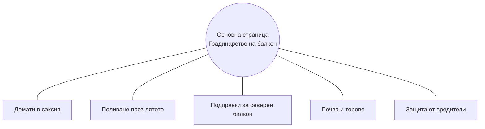

# Модул 08. SEO и маркетинг на съдържанието

## Цели на урока

След този урок ученикът може да:

* обясни как търсачките избират кои страници да покажат;
* направи проучване на ключови думи и да разпознае намерението зад търсенето;
* оптимизира страница (заглавие, описание, структура);
* планира съдържание, което привлича и задържа клиенти;
* разбере как AI в търсенето променя SEO.

## 1. Защо SEO още има значение

Когато човек пише в Google „ремонт на климатик Бургас“, той има проблем точно сега. Това е най-топлият клиент, когото можеш да получиш. Ако си на първа страница, получаваш го без да плащаш за всеки клик.

**SEO, search engine optimisation (оптимизация за търсачки)** е работата, която прави сайта ти видим в безплатните (органичните) резултати.

> **Опитай сам.** Потърси в Google „ремонт на телефон“ плюс твоя град. Кои бизнеси са в картата, кои в рекламите и кои в органичните резултати? Би ли кликнал на същите, ако търсеше спешно?

## 2. Как работи търсачката, просто казано

1. **Crawling (обхождане):** роботите на Google обикалят интернет по линковете.
2. **Indexing (индексиране):** записват какво има на всяка страница.
3. **Ranking (класиране):** при търсене подреждат страниците по това колко добре отговарят на въпроса и колко им се вярва.

Google оценява стотици сигнали, но можем да ги групираме в три:

* **Съдържание:** отговаря ли страницата на това, което човекът търси?
* **Технически:** бърза ли е, работи ли на телефон, могат ли роботите да я прочетат?
* **Авторитет:** други сайтове препращат ли към теб, има ли ревюта, кой стои зад съдържанието?

### E-E-A-T

Google иска съдържанието да показва **Experience (опит), Expertise (експертиза), Authoritativeness (авторитетност), Trustworthiness (надеждност)**. Статия за грижа за кожата, написана от дерматолог, с реални снимки и източници, печели пред анонимен текст.

> **Опитай сам.** Потърси „site:“ плюс адреса на сайта на твоето училище в Google. Колко страници са индексирани? Има ли нещо, което не би трябвало да е публично?

## 3. Ключови думи и намерение

### Search intent (намерение зад търсенето)

| Вид | Какво иска човекът | Пример | Каква страница му трябва |
|---|---|---|---|
| Информационно | Да научи | „как се засажда лавандула“ | Статия, видео |
| Навигационно | Да стигне до сайт | „еМАГ вход“ | Началната страница |
| Търговско проучване | Да сравни | „най-добрата прахосмукачка робот 2026“ | Сравнение, ревю |
| Транзакционно | Да купи | „купи разсад лавандула“ | Продуктова страница |

Най-честата грешка: продуктова страница се опитва да се класира за информационно търсене или обратното.

### Short tail и long tail

* **Short tail (кратки фрази):** „обувки“. Огромно търсене, огромна конкуренция, неясно намерение.
* **Long tail (дълги фрази):** „дамски обувки за сватба без ток бежови“. По-малко търсене, но човекът знае какво иска и е по-близо до покупка.

Малкият бизнес печели в long tail.

### Инструменти

* **Google Autocomplete:** започни да пишеш и виж какво предлага.
* **„Хората питат също“** в резултатите.
* **Google Search Console:** безплатен, показва за кои търсения вече се показваш.
* **Google Keyword Planner:** в Google Ads, дава ориентировъчен обем.
* Платени: Semrush, Ahrefs, Ubersuggest.

> **Опитай сам.** Започни да пишеш в Google „подарък за“ и запиши 10 предложения от Autocomplete. Раздели ги по намерение: информационно, търговско проучване, транзакционно.

## 4. On-page SEO (оптимизация на страницата)

* **Title tag (заглавие на страницата):** синият ред в Google. До около 60 символа, с основната фраза отпред. Пример: „Торти по поръчка в Пловдив | Сладкарница Мелба“.
* **Meta description (мета описание):** текстът под заглавието. Не влияе пряко на класирането, но влияе дали ще кликнат. Около 150 символа, с полза и призив.
* **H1 и подзаглавия:** един H1 на страница, логична структура.
* **URL:** кратък и смислен. `/torti-rozhden-den` вместо `/p?id=4471`.
* **Снимки:** малък размер, описателно име на файла, алтернативен текст.
* **Вътрешни линкове:** свържи свързаните страници.
* **Съдържание:** отговаря напълно на въпроса, по-добре от конкурентите.

> **Опитай сам.** Виж в Google как изглежда резултатът за Хеликон и за една малка книжарница. Сравни заглавията и описанията. Напиши по-добро заглавие и описание за малката.

## 5. Off-page SEO и локално SEO

**Backlinks (входящи линкове)** от уважавани сайтове са като препоръки. Как се печелят честно: полезно съдържание, участие в медии, партньорства с местни организации, събития.

**Local SEO (локално SEO)** е най-важното за местните бизнеси:

* пълен и проверен **Google Business Profile (бизнес профил в Google)**: категория, работно време, снимки, услуги;
* ревюта и отговори на всяко ревю;
* еднакви име, адрес и телефон навсякъде онлайн;
* локални фрази на сайта („в квартал Лозенец“).

> **Опитай сам.** Провери Google Business Profile на любимото ти кафене: снимки, работно време, ревюта, отговори на ревютата. Дай им три конкретни съвета.

## 6. AI в търсенето

Google показва **AI Overviews (обобщения от AI)** над резултатите, а много хора питат директно ChatGPT, Gemini или Perplexity. Какво значи това:

* по-малко кликове за прости информационни въпроси;
* по-голяма стойност на уникалното: собствен опит, данни, мнение, снимки;
* важно е да си цитиран като източник, затова ясната структура, конкретните отговори и доверието тежат още повече;
* брандът започва да е сигнал: хората питат „добра ли е марката Х“.

Понякога ще срещнете термина **GEO, generative engine optimisation (оптимизация за генеративни търсачки)**. Основите са същите като при доброто SEO.

> **Опитай сам.** Попитай ChatGPT или Gemini „Кой е най-добрият онлайн магазин за спортни стоки в България?“. Кои марки споменава и откъде според теб идва тази информация?

## 7. Маркетинг на съдържанието

**Content marketing (маркетинг на съдържанието)** е създаването на полезно съдържание, което привлича хората, преди да са готови да купят, и изгражда доверие.

### Видове съдържание

* статии и ръководства;
* видео уроци и кратки видеа;
* калкулатори и тестове („Какъв тип кожа имаш“);
* казуси и истории на клиенти;
* шаблони и чеклисти за изтегляне (lead magnet, примамка за контакти);
* подкасти, бюлетини.

### Модел хъб и спици

**Pillar page (основна страница)** покрива голяма тема изцяло, например „Пълно ръководство за градинарство на балкон“. **Cluster pages (свързани страници)** развиват подтеми: „Домати в саксия“, „Поливане през лятото“, „Подправки за северен балкон“. Всички се свързват помежду си. Така Google разбира, че си експерт по темата.

### Съдържанието по етапите на RACE

| Етап | Съдържание |
|---|---|
| Reach | Полезни статии, видеа, които отговарят на въпроси |
| Act | Тестове, сравнения, ръководства за избор |
| Convert | Казуси, ревюта, демонстрации, гаранции |
| Engage | Съвети за ползване, общност, ексклузивно съдържание |

### Редакционен календар

Таблица с дати, теми, формат, канал, автор, ключова фраза и статус. Свързва се със сезонността: в България сезоните са ясни (мартеници, бал, ваканция, първи учебен ден, Black Friday, Коледа).

> **Опитай сам.** Направи модел хъб и спици за блога на Sopharmacy или dm България по тема „Грижа за кожата през зимата“. Основна страница и пет свързани статии.

## Въпроси за дискусия

1. Потърси в Google нещо, което ти трябва. Кликна ли на реклама, на AI обобщението или на органичен резултат? Защо?
2. Какво съдържание би направил за автосервиз, така че хората да го харесват, а не да го прескачат?
3. Как би се отличил блог за рецепти, когато AI може да напише рецепта за секунди?

## Ключови термини

| Термин | Превод |
|---|---|
| SEO | оптимизация за търсачки |
| Organic results | органични, безплатни резултати |
| SERP | страница с резултати от търсене |
| Keyword | ключова дума или фраза |
| Search intent | намерение зад търсенето |
| Long tail | дълги, конкретни фрази |
| Title tag / meta description | заглавие на страницата / мета описание |
| Backlink | входящ линк |
| Local SEO | локално SEO |
| E-E-A-T | опит, експертиза, авторитетност, надеждност |
| Content marketing | маркетинг на съдържанието |
| Lead magnet | полезен материал срещу контакт |
| Pillar page | основна тематична страница |
