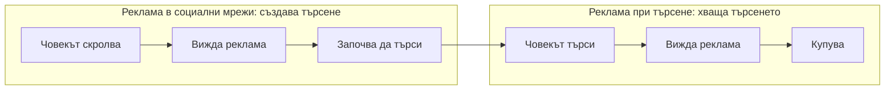
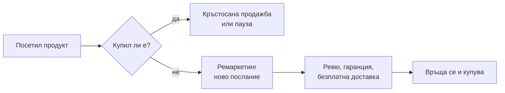

# Модул 09. Платена дигитална реклама

## Цели на урока

След този урок ученикът може да:

* разграничи рекламата при търсене от рекламата в социалните мрежи;
* обясни моделите на плащане (CPC, CPM, CPA);
* изчисли основните показатели: CTR, CPC, CPA, ROAS;
* структурира проста кампания в Google Ads и в Meta;
* планира ремаркетинг.

## 1. Две големи семейства

| | Реклама при търсене | Реклама в социални мрежи и дисплей |
|---|---|---|
| Как работи | Човекът търси, ти се показваш | Ти показваш на хора, които може да се заинтересуват |
| Намерение | Високо: търси сега | Ниско до средно: не е търсил |
| Пример | Google Ads по „ключар София“ | Реклама в Instagram на нова марка бански |
| Силно в | Реализация на съществуващо търсене | Създаване на търсене, нови продукти, визуални продукти |

С други думи: рекламата при търсене **хваща** търсенето, социалните реклами го **създават**.

## 2. Как се плаща

* **CPC, cost per click (цена на клик):** плащаш, когато някой кликне.
* **CPM, cost per mille (цена на 1000 показвания):** плащаш за видимост.
* **CPA, cost per acquisition (цена на реализация):** колко ти струва една поръчка или запитване. Може да е цел, по която системата оптимизира.

Рекламата работи като търг. Не плащаш фиксирана цена, а се състезаваш с други рекламодатели за мястото. Печели не само най-високата оферта, а комбинацията от оферта, качество на рекламата и вероятност хората да реагират.

## 3. Показателите, които трябва да можеш да смяташ

* **CTR, click-through rate (процент кликове)** = кликове ÷ показвания × 100
* **CPC** = разход ÷ кликове
* **Conversion rate (коефициент на реализация)** = реализации ÷ кликове × 100
* **CPA** = разход ÷ реализации
* **ROAS, return on ad spend (приход от рекламен разход)** = приход от рекламата ÷ разход

### Пример

Онлайн магазин за детски дрехи харчи 600 € в Google за месец.

* показвания: 60 000
* кликове: 1 500
* поръчки: 45
* приход от поръчките: 2 700 €

CTR = 2,5%; CPC = 0,40 €; коефициент на реализация = 3%; CPA = 13,33 €; ROAS = 4,5 (на 1 € реклама се връщат 4,50 € приход).

**Внимание:** ROAS е приход, не печалба. Ако маржът е 30%, от 2 700 € приход печалбата преди рекламата е 810 €. След 600 € реклама остават 210 €. Печелиш, но по-малко, отколкото изглежда. Затова мислим и за стойността на клиента във времето (модул 06).

## 4. Google Ads

### Видове кампании

* **Search (търсене):** текстови реклами в резултатите.
* **Shopping:** продукт със снимка и цена. За онлайн магазини.
* **Performance Max:** AI кампания, която разпределя рекламите във всички мрежи на Google (търсене, YouTube, Gmail, карти, дисплей). Силна е, но дава по-малко контрол и иска добри данни за реализациите.
* **Display (дисплей):** банери в сайтове от мрежата на Google.
* **YouTube / Video:** видео реклами.
* **Demand Gen:** визуални реклами в YouTube, Discover и Gmail.

### Структура

Акаунт → Кампании (бюджет, цел, локация) → Рекламни групи (теми) → Ключови думи и реклами.

### Ключови думи: съвпадение

* **Broad match (широко съвпадение):** рекламата се показва и за свързани търсения. Работи добре с умно наддаване и добри данни, иначе харчи за неподходящи търсения.
* **Phrase match (фразово):** търсенето съдържа смисъла на фразата.
* **Exact match (точно):** търсенето е със същото значение.
* **Negative keywords (отрицателни ключови думи):** думи, за които НЕ искаш да се показваш. Магазин за нови телефони добавя „втора ръка“, „ремонт“, „безплатно“.

## 5. Meta: Facebook и Instagram

### Цели на кампанията

Awareness (осведоменост), Traffic (трафик), Engagement (ангажираност), Leads (контакти), App promotion (приложение), Sales (продажби). Избираш целта, която отговаря на бизнес резултата. Ако искаш продажби, а избереш „ангажираност“, ще получиш харесвания от хора, които не купуват.

### Аудитории

* **Core audiences (основни):** по локация, възраст, интереси.
* **Custom audiences (персонализирани):** посетители на сайта, имейл списък на клиенти (със съгласие), хора, гледали видео.
* **Lookalike audiences (подобни аудитории):** хора, подобни на най-добрите ти клиенти.
* **Advantage+:** автоматизирано насочване, при което системата сама търси купувачи. Все по-често работи по-добре от ръчното, ако пикселът събира качествени данни.

### Креатив: най-важният лост

В Meta креативът е новото таргетиране. Добрата реклама:

* спира скролването в първите 2 секунди;
* е вертикална за Reels и Stories;
* има субтитри (повечето гледат без звук);
* показва продукта в употреба, реални хора;
* има ясен призив.

Тествай няколко креатива едновременно и оставяй системата да намери печелившия.

### Pixel и Conversions API

**Meta Pixel** е код на сайта, който казва на Meta кой какво е направил след рекламата. **Conversions API** изпраща същата информация от сървъра, по-надеждно, когато браузърите блокират. И двете зависят от съгласието на посетителя за бисквитките.

## 6. Ремаркетинг

**Remarketing (ремаркетинг)** е показване на реклами на хора, които вече са били при теб: разгледали продукт, оставили количка, гледали видео. Обикновено е с по-ниска цена на реализация, защото хората вече те познават.

Добро правило: показвай им различно послание, не същото. Ако са разгледали продукт и не са купили, кажи им нещо ново: ревю, гаранция, безплатна доставка, отговор на съмнение.

Внимавай с честотата. Реклама, която те гони две седмици, дразни.

## 7. Други платформи

* **TikTok Ads:** силен за по-млада аудитория и за продукти, които се показват добре във видео.
* **LinkedIn Ads:** скъп, но точен за B2B (по длъжност, компания, индустрия).
* **YouTube:** обучителни и демонстрационни видеа.
* **Retail media (реклама в търговски платформи):** платени позиции в eMAG и други маркетплейси. Клиентът е на крачка от покупката.
* **Pinterest:** за дом, мода, сватби, рецепти.

## 8. Бюджет и тестване

* Започни с бюджет, който позволява поне няколко десетки реализации месечно, за да се учат алгоритмите.
* Не променяй всичко всеки ден. Алгоритмите имат период на обучение.
* Сравнявай по CPA и ROAS, не по CTR.
* Отделяй марковите търсения (името на фирмата) от останалите, иначе отчетите изглеждат по-добре, отколкото са.

## Въпроси за дискусия

1. Коя последна реклама в Instagram те накара да кликнеш? Какво точно те спря?
2. Защо адвокатска кантора би избрала Google Ads, а марка за бижута Instagram?
3. Етично ли е ремаркетингът да те следва дни наред? Къде е границата?

## Ключови термини

| Термин | Превод |
|---|---|
| PPC, pay per click | плащане на клик |
| CPC / CPM / CPA | цена на клик / на 1000 показвания / на реализация |
| CTR | процент на кликовете |
| ROAS | приход от рекламния разход |
| Impression | показване |
| Bid / auction | оферта / търг |
| Match type | тип съвпадение на ключовата дума |
| Negative keyword | отрицателна ключова дума |
| Custom / lookalike audience | персонализирана / подобна аудитория |
| Creative | рекламен креатив, визията и текстът на рекламата |
| Remarketing / retargeting | ремаркетинг, повторно достигане |
| Frequency | честота на показване на един човек |
