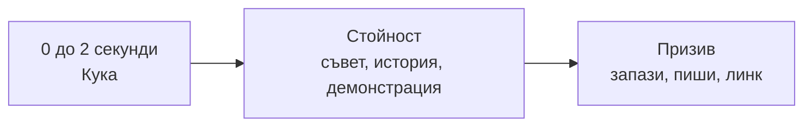

# Модул 10. Социални мрежи и инфлуенсър маркетинг

## Цели на урока

След този урок ученикът може да:

* избере подходящите социални мрежи за конкретен бизнес;
* планира съдържание по стълбове и формати;
* разграничи органичен обхват от платен;
* избере и оцени инфлуенсър;
* реагира на негативен коментар и на малка криза.

## 1. Социалните мрежи днес

Социалните мрежи вече не са място само за приятели. Те са търсачка (младите търсят ресторанти в TikTok), магазин (покупки директно от публикация), телевизия (кратки видеа) и служба за обслужване на клиенти (съобщения).

Важна промяна: платформите показват все повече съдържание от профили, които не следваш, избрано от алгоритъм по интерес. Това значи, че броят последователи е по-малко важен, а **качеството на всяка отделна публикация е по-важно**.

> **Опитай сам.** Засечи 10 минути в TikTok или Instagram. Колко от видеата са от профили, които не следваш? Какво ти казва това за броя последователи?

## 2. Коя платформа за какво

| Платформа | Силна страна | Подходяща за |
|---|---|---|
| Facebook | Широка аудитория, групи, събития, по-възрастни потребители | Местни бизнеси, общности, събития |
| Instagram | Визуално, Reels, Stories, съобщения | Мода, храна, красота, туризъм, дизайн |
| TikTok | Откриване чрез алгоритъм, тенденции, автентичност | Марки за млади хора, забавни и обучителни формати |
| YouTube | Дълго и кратко видео, търсене | Обучения, ревюта, техника |
| LinkedIn | Професионални контакти | B2B, работодателска марка, личен бранд на експерти |
| Pinterest | Вдъхновение и планиране | Дом, сватби, рецепти, мода |
| Threads, X | Разговор в реално време | Новини, медии, технологии |

Правило: по-добре две платформи, поддържани добре, отколкото пет, изоставени.

> **Опитай сам.** Избери Vivacom, Yettel и A1. Коя платформа ползва всяка най-активно и към каква аудитория говори там?

## 3. Стратегия за съдържанието

### Content pillars (стълбове на съдържанието)

Три до пет теми, около които се върти всичко. Пример за кафене:

1. **Занаят:** как се прави добро кафе, произход на зърната.
2. **Хора:** баристите, редовните клиенти.
3. **Квартал:** събития, местни истории.
4. **Оферти:** нови напитки, сезонни специалитети.

### Пропорция

Повечето съдържание трябва да е полезно, забавно или вдъхновяващо. Прякото продаване е по-малката част. Ако всяка публикация е „купи“, хората спират да гледат.

### Формати

* **Кратко видео (Reels, TikTok, Shorts):** най-голям органичен обхват.
* **Карусели:** за съвети и стъпки, хората ги запазват.
* **Stories:** ежедневие, анкети, бърза връзка.
* **На живо:** въпроси и отговори, представяне на продукт.
* **UGC, user generated content (съдържание от потребителите):** клиентите снимат и споделят. Най-убедителното съдържание.

### Структура на кратко видео

1. **Hook (кука), 0 до 2 секунди:** въпрос, изненада, движение, текст на екрана.
2. **Стойност:** съветът, историята, демонстрацията.
3. **Призив:** „запази си го“, „пиши ни“, „линк в профила“.

> **Опитай сам.** Определи стълбовете на съдържанието на Девин или Верея по последните им 12 публикации. Колко са продаващи и колко забавни или полезни?

## 4. Органично и платено

* **Organic reach (органичен обхват):** хората, до които стига публикацията без плащане.
* **Paid reach (платен обхват):** чрез реклама.

Двете се допълват. Органичното показва кое съдържание работи. Най-добрите органични публикации стават реклами.

> **Опитай сам.** Намери органична публикация на марка, която после виждаш и като реклама (провери в Meta Ad Library). Защо според теб са избрали точно нея?

## 5. Показатели

| Показател | Какво казва |
|---|---|
| Reach (обхват) | До колко уникални хора стигна |
| Impressions (показвания) | Колко пъти е показано общо |
| Engagement rate (ангажираност) | Взаимодействия спрямо обхвата или последователите |
| Saves и shares (запазвания и споделяния) | Най-ценните сигнали, че съдържанието е полезно |
| Watch time, retention (време за гледане, задържане) | Докъде гледат видеото |
| Clicks (кликове) | Колко отиват към сайта |
| Conversions (реализации) | Колко купуват или пишат |

**Vanity metrics (суетни показатели)** са харесванията и броят последователи, когато не водят до нищо. Изглеждат добре в отчета, но не плащат заплати.

> **Опитай сам.** Сравни три публикации на един профил по запазвания и коментари (ако се виждат). Коя е най-полезна според тези сигнали?

## 6. Social listening (слушане в социалните мрежи)

Следиш какво се говори за марката, конкурентите и темата, дори когато не те отбелязват. Инструменти: Brand24, Mention, вградените известия, ръчно търсене. Ползи: намираш недоволни клиенти, идеи за продукти, теми за съдържание.

> **Опитай сам.** Потърси името на голяма българска марка (например Еконт) в социалните мрежи и в Google новини за последната седмица. За какво говорят хората? Има ли проблем, на който марката трябва да отговори?

## 7. Общност и обслужване

* Отговаряй бързо на съобщения и коментари.
* Отговаряй на всеки въпрос, дори публично („Пишем ти на лично“).
* Благодари за хубавите думи и споделяй клиентското съдържание (с разрешение).

### Как се отговаря на негативен коментар

1. Не изтривай (освен при обиди и спам).
2. Отговори бързо и спокойно.
3. Признай проблема, без да се оправдаваш.
4. Премести разговора на лично за детайлите.
5. Поправи и, ако е уместно, разкажи публично какво си поправил.

Пример: „Мария, съжаляваме, че тортата пристигна смачкана, това не е нашият стандарт. Писахме ти на лично, за да я заменим още днес.“

### Малка криза

Ако нещо се разпространява бързо: спри планираните публикации, събери фактите, отговори с едно ясно изявление, бъди честен, следи реакциите, научи урока.

> **Опитай сам.** Намери публичен негативен коментар към български бизнес и отговора му (ако има). Оцени отговора по петте стъпки от урока и напиши по-добър.

## 8. Influencer marketing (инфлуенсър маркетинг)

### Видове според размера

| Вид | Последователи (ориентировъчно) | Особености |
|---|---|---|
| Нано | до 10 000 | Много висока ангажираност и доверие, евтино, подходящо за местни бизнеси |
| Микро | 10 000 до 100 000 | Нишова аудитория, добро съотношение цена и ефект |
| Макро | 100 000 до 1 млн. | Голям обхват, по-скъпо |
| Мега | над 1 млн. | Известни личности, обхват, по-ниско доверие |

В България аудиториите са по-малки, затова тези граници са условни. Профил с 30 000 активни последователи тук е силен.

### Как се избира

* Аудиторията съвпада ли с твоя клиент (възраст, град, интереси)? Поискай статистиката.
* Реална ли е ангажираността? Внимавай за еднакви коментари, рязък ръст на последователите.
* Ценностите съвпадат ли с марката?
* Как изглеждат предишните му реклами? Естествени ли са?

### Как се работи

* Ясен бриф: цел, ключови послания, какво не може, срокове, обозначаване като реклама.
* Свобода в стила. Хората следват инфлуенсъра заради неговия глас.
* Уникален код или линк за измерване.
* Права върху съдържанието, ако искаш да го ползваш в реклами.

### Creators (създатели на съдържание) и UGC криейтъри

Все повече марки плащат на създатели само за съдържание (видео с продукта), което после пускат като реклама от своя профил. Не им трябва голяма аудитория, а умение да правят автентично видео.

> **Опитай сам.** Намери двама български микро инфлуенсъри в тема, която те интересува. Провери обозначават ли сътрудничествата си и дали аудиторията им изглежда реална.

## 9. Инструменти на практика

Инструментите за тази тема са в отделен урок с упражнения стъпка по стъпка, задачи и тест: [Модул 17. Социални мрежи на практика: инструменти](#/17/urok).

## Въпроси за дискусия

1. Кой български профил на марка следвате с удоволствие? Защо?
2. Кога сътрудничество с инфлуенсър ви е изглеждало фалшиво?
3. Ако сте мениджър на социалните мрежи на училището, кои три стълба на съдържанието бихте избрали?

## Ключови термини

| Термин | Превод |
|---|---|
| Content pillars | стълбове на съдържанието |
| Hook | кука, първите секунди, които задържат вниманието |
| Organic / paid reach | органичен / платен обхват |
| Engagement rate | процент на ангажираност |
| Vanity metrics | суетни показатели |
| UGC | съдържание, създадено от потребителите |
| Social listening | слушане в социалните мрежи |
| Community management | управление на общността |
| Influencer / creator | инфлуенсър / създател на съдържание |
| Brief | задание, бриф |
