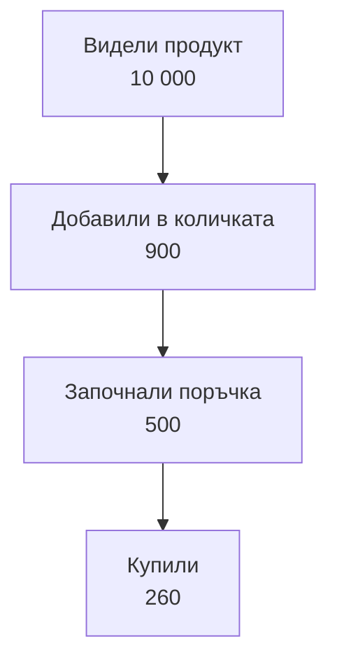
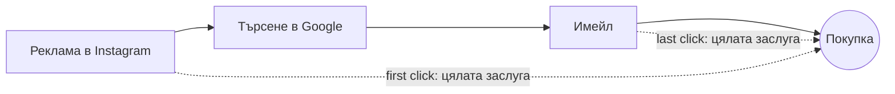

# Модул 11. Измерване, анализ и оптимизация

## Цели на урока

След този урок ученикът може да:

* избере KPI според целта и етапа на клиента;
* разчете основните отчети в Google Analytics 4;
* използва UTM параметри, за да знае откъде идват посетителите;
* обясни какво е атрибуция и защо различните платформи „броят“ различно;
* направи прост месечен отчет с изводи и действия.

## 1. Защо измерваме

„Половината от парите, които харча за реклама, отиват на вятъра. Проблемът е, че не знам коя половина.“ Тази стара фраза описва маркетинга преди интернет. Онлайн можем да знаем много повече, ако сме настроили измерването правилно.

Измерването има смисъл само ако води до решение. Отчет, след който нищо не се променя, е загубено време.

> **Опитай сам.** Помисли за последната кампания, която си видял от училището или от любим бизнес. Какво би измерил, за да знаеш дали е успяла?

## 2. От целта към показателя

Връщаме се към пирамидата от модул 04 и към RACE от модул 01:

| Етап | Въпрос | Примерни KPI |
|---|---|---|
| Reach | Достигаме ли до правилните хора? | Посещения, нови потребители, обхват, показвания в търсенето, дял на органичния трафик |
| Act | Интересуват ли се? | Ангажирани сесии, време, разгледани продукти, абонаменти, добавяния в количката |
| Convert | Купуват ли? | Коефициент на реализация, брой поръчки, приход, средна стойност на поръчката, CPA |
| Engage | Връщат ли се? | Повторни покупки, CLV, ревюта, отписвания, NPS |

**NPS, net promoter score (индекс на нетните препоръчители):** питаш „Колко вероятно е да ни препоръчате от 0 до 10?“. От процента на хората, дали 9 или 10, вадиш процента на хората, дали от 0 до 6.

> **Опитай сам.** Избери Booking.com и посочи по един KPI за всеки етап от RACE, който според теб те следят.

## 3. Google Analytics 4

**GA4** е безплатният инструмент на Google за измерване на сайтове и приложения. Работи с **events (събития)**: всяко действие е събитие. Преглед на страница, скрол, клик, добавяне в количката, покупка.

### Основни понятия

* **Users (потребители):** колко различни хора.
* **Sessions (сесии):** посещения.
* **Engaged sessions (ангажирани сесии):** сесии над 10 секунди, с поне две страници или с реализация.
* **Engagement rate (процент на ангажираност):** дял на ангажираните сесии. Обратното е bounce rate (процент на отпадане).
* **Key events (ключови събития):** събитията, които сме отбелязали като важни, например покупка или изпратена форма.

### Отчетите, които да гледаш първо

1. **Acquisition (придобиване):** откъде идват хората. Канали: Organic Search, Paid Search, Organic Social, Paid Social, Email, Referral, Direct.
2. **Engagement (ангажираност):** кои страници гледат, какви събития правят.
3. **Monetisation (приходи):** за онлайн магазини, продажби по продукт.
4. **Explorations (изследвания):** фунии, пътеки, сегменти.

### Фуния

Пример за онлайн магазин:

| Стъпка | Потребители | Преминали към следващата |
|---|---|---|
| Видели продукт | 10 000 | |
| Добавили в количката | 900 | 9% |
| Започнали поръчка | 500 | 56% |
| Купили | 260 | 52% |

Къде е най-голямата загуба? Между продукта и количката. Значи работим върху продуктовата страница (модул 07), а не върху рекламата.

> **Опитай сам.** Отвори демо акаунта на Google Analytics (Google Merchandise Store). Намери отчета за придобиване: кой канал носи най-много потребители?

## 4. UTM параметри

Ако пуснеш линк в бюлетин или в Instagram, как ще разбереш колко поръчки е донесъл? С **UTM параметри**: етикети в края на линка.

Пример:
`https://primer.bg/torti?utm_source=instagram&utm_medium=social&utm_campaign=svatbi2027`

* **utm_source:** откъде (instagram, newsletter, viber);
* **utm_medium:** какъв тип канал (social, email, cpc);
* **utm_campaign:** коя кампания.

Правило: малки букви, без интервали, една и съща система навсякъде. Иначе „Instagram“ и „instagram“ се броят като два различни източника.

Безплатен инструмент за генериране: Google Campaign URL Builder.

> **Опитай сам.** Направи с Google Campaign URL Builder три UTM линка за един и същ сайт: за Instagram Story, за бюлетин и за Viber общност.

## 5. Атрибуция

Клиентът видял реклама в Instagram, после търсил в Google, после получил имейл и купил. Кой канал „заслужава“ продажбата? Това е въпросът на **attribution (атрибуцията)**.

| Модел | Как разпределя заслугата |
|---|---|
| Last click (последен клик) | Всичко за последния канал (тук имейла) |
| First click (първи клик) | Всичко за първия (тук Instagram) |
| Linear (линеен) | Поравно между всички |
| Data-driven (базиран на данни) | Алгоритъм преценява приноса на всеки канал. По подразбиране в GA4 |

### Защо платформите не са съгласни

Meta отчита продажба, ако човекът е видял рекламата и е купил до няколко дни по-късно. Google отчита своите кликове. Ако съберете отчетите, сумата е по-голяма от реалните продажби. Затова:

* имай един източник на истината (реалните поръчки в магазина или CRM);
* гледай общите числа: ако спреш канал, падат ли продажбите?
* **MER, marketing efficiency ratio (коефициент на маркетинговата ефективност)** = общ приход ÷ общ маркетингов разход. Груб, но честен показател.

> **Опитай сам.** Нарисувай своя път до последната ти покупка: кои канали те докоснаха? Кой канал би получил заслугата при first click, last click и линеен модел?

## 6. Съгласие и данни

Без съгласие за бисквитките част от посетителите не се измерват пълно. С Consent Mode Google моделира липсващите данни. Важно: данните никога не са 100% точни. Търсим тенденции, не точни бройки.

> **Опитай сам.** Посети сайт и откажи бисквитките. После посети друг и ги приеми. Как мислиш, какво от теб виждат и не виждат собствениците на двата сайта?

## 7. Отчет, който някой ще прочете

Добрият месечен отчет е кратък:

1. **Резюме в три изречения:** какво се случи и какво решаваме.
2. **Показатели спрямо целта и спрямо миналия месец:** таблица.
3. **Какво проработи и защо.**
4. **Какво не проработи и защо.**
5. **Действия за следващия месец:** конкретни, с отговорник.

Инструменти за табла: Looker Studio (безплатен, свързва GA4, Google Ads, таблици), Google Sheets.

> **Опитай сам.** Напиши резюме в три изречения за данните от практическата задача в модула (магазин „Детски свят“), сякаш го пращаш на собственика.

## 8. Тестване и подобрение

Цикълът е: **измерваш → откриваш проблем → хипотеза → тест → пак измерваш.**

Пример: имейл бюлетинът има CTR 1%. Хипотеза: по-кратък имейл с един основен призив ще вдигне кликовете. Тест: две версии на половината списък. Резултат: 1,8%. Решение: всички бюлетини стават по-кратки.

> **Опитай сам.** Предложи A/B тест за бюлетина на книжарница: една хипотеза, една промяна, показател за успех и колко време ще чакаш.

## 9. Microsoft Clarity и Google Search Console

Два безплатни инструмента, с които започва всяко измерване на сайт. Search Console показва как те вижда Google, а Clarity показва какво правят хората, след като влязат.

* **[Microsoft Clarity](https://clarity.microsoft.com/)** (безплатен). Поставяте кратък код на сайта и виждате къде кликат посетителите, докъде скролват и къде се отказват. Започнете с него.
* **[Hotjar](https://www.hotjar.com/)** (безплатен план). Прави същото като Clarity и добавя анкети и въпроси към посетителите.
* **[Google Search Console](https://search.google.com/search-console/about)** (безплатен). Задължителен за всеки собствен сайт. Показва по кои думи ви намират, колко хора кликат и има ли технически проблеми.

> **Опитай сам.** Ако имаш свой сайт (или училищен, с разрешение), добави го в Google Search Console и сложи кода на Microsoft Clarity. След седмица запиши по кои думи те намират и докъде скролват посетителите на началната страница.

Пълният каталог с инструменти за маркетинг и AI е тук: [Основни инструменти за маркетинг и изкуствен интелект](https://github.com/kikiaangelova/marketing-ai-resources/blob/main/marketing-ai-instrumenti.md).

## Въпроси за дискусия

1. Ако магазинът има повече посещения, но по-малко поръчки от миналия месец, какви три неща би проверил първо?
2. Защо е опасно да вярваш само на отчета от рекламната платформа?
3. Какъв KPI би избрал за училищния сайт?

## Ключови термини

| Термин | Превод |
|---|---|
| KPI | ключов показател за ефективност |
| Web analytics | уеб анализ |
| GA4 | Google Analytics 4 |
| Event / key event | събитие / ключово събитие |
| Session / user | сесия / потребител |
| Engagement rate / bounce rate | процент на ангажираност / процент на отпадане |
| Funnel | фуния |
| UTM parameters | етикети за проследяване на линкове |
| Attribution | атрибуция, разпределяне на заслугата между каналите |
| MER | общ приход спрямо общ маркетингов разход |
| NPS | индекс на нетните препоръчители |
| Dashboard | табло с показатели |
