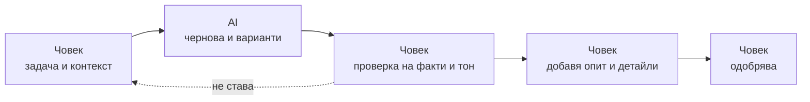

# Модул 12. Изкуственият интелект в маркетинга

## Цели на урока

След този урок ученикът може да:

* опише къде AI вече работи в маркетинга, видимо и невидимо;
* напише добра инструкция (prompt) за маркетингова задача;
* провери и подобри текст, генериран от AI;
* разпознае етичните и правните рискове;
* прецени кои задачи да поеме AI и кои остават за човека.

## 1. AI не е бъдеще, а настояще

Повечето маркетолози вече работят с AI всеки ден, често без да се замислят:

* рекламите в Google и Meta се насочват и оптимизират от алгоритми;
* препоръките „може да харесате и“ в онлайн магазините;
* търсенето в Google с AI обобщения;
* автоматичните субтитри и преводи;
* чатботовете в сайтовете.

Новото от последните години е **генеративният AI**: инструменти, които създават текст, изображения, видео и код по инструкция. ChatGPT, Claude, Gemini, Copilot, Midjourney, Canva Magic Studio, CapCut и много други.

По данни на НСИ през 2025 г. едва 8,5% от българските предприятия с 10 и повече заети ползват технологии с изкуствен интелект. Това означава, че който се научи да ги ползва разумно, има предимство.

> **Опитай сам.** Запиши за един ден къде ти е помогнал или повлиял AI: препоръки, търсене, филтри, преводи. Колко неща намери?

## 2. Къде помага AI в маркетинга

| Етап | Как помага | Пример |
|---|---|---|
| Проучване | Обобщава ревюта, групира теми, генерира хипотези | Анализ на 300 ревюта на конкурент за 2 минути |
| Стратегия | Партньор за обсъждане, контрааргументи, рамки | „Какво пропускам в тази SWOT?“ |
| Съдържание | Чернови, варианти на заглавия, сценарии, преводи | 10 варианта на кука за видео |
| Визуални материали | Изображения, фонове, адаптация на формати | Една снимка в 5 формата за различни платформи |
| Реклама | Автоматично насочване и креативи | Advantage+, Performance Max |
| Обслужване | Чатботове, отговори на чести въпроси | Бот, който отговаря за статуса на пратката |
| Анализ | Обяснява таблици, пише формули, открива аномалии | „Защо спаднаха продажбите във вторник?“ |
| Персонализация | Съдържание според сегмента | Различен имейл за нови и за лоялни клиенти |

> **Опитай сам.** Избери една задача от таблицата и я изпробвай в AI инструмент за реален български бизнес по твой избор, например собствено кафене в твоя квартал. Свърши ли работа?

## 3. Как се пише добра инструкция

Резултатът зависи от инструкцията. Слабата инструкция дава общ, скучен текст.

**Слаба:** „Напиши пост за Instagram за пекарна.“

**Силна:** „Ти си копирайтър за малка семейна пекарна в Стара Загора, която прави хляб с квас от 1998 г. Аудиторията са жени и мъже от 30 до 55 г., които ценят натуралните продукти. Напиши три варианта на текст за Instagram Reels (до 150 знака) за новия ни ръжен хляб с орехи. Тонът е топъл, без преувеличения и без думи като „уникален“ и „невероятен“. Всеки вариант да завършва с покана да минат сутрин до 9 ч., когато хлябът е топъл.“

### Формула

1. **Роля:** кой да бъде AI.
2. **Контекст:** бизнесът, клиентът, ситуацията.
3. **Задача:** какво точно да направи.
4. **Формат:** дължина, брой варианти, структура.
5. **Ограничения:** тон, думи, които да избягва, какво не бива.
6. **Пример:** ако имаш текст, който харесваш, покажи го.

После **итерираш:** „Вариант 2 е най-близо. Направи го по-кратък и добави нещо за децата.“

> **Опитай сам.** Напиши слаба и силна инструкция за пост в Instagram за SoftUni Buditel. Сравни резултатите.

## 4. Човекът в процеса

AI е бърз стажант, който никога не се уморява, но понякога уверено греши. Затова:

* **проверявай фактите:** AI може да измисли статистика, източник или цитат;
* **проверявай тона:** генерираните текстове често звучат еднакво и „рекламно“;
* **добавяй това, което AI няма:** твоя опит, истински истории, местни подробности, мнение;
* **проверявай за пристрастия:** изображенията и текстовете могат да повтарят стереотипи.

### Как да направиш AI текста по-човешки

* махни общите фрази („в днешния динамичен свят“, „открийте магията“);
* добави конкретика: име, място, число, детайл;
* съкрати с една трета;
* прочети го на глас: така ли говори твоята марка?

> **Опитай сам.** Помоли AI да ти напише 3 статистики за онлайн пазаруването в България с източници. Провери всяка. Колко са верни?

## 5. Етика и право

* **Прозрачност:** реалистично генерирано съдържание, което може да заблуди (лице, глас, събитие), трябва да е обозначено. Чатботът трябва да казва, че е бот. Изискванията за прозрачност по Акта за изкуствения интелект на ЕС се въвеждат поетапно.
* **Лични данни:** не качвай в публични AI инструменти лични данни на клиенти, договори или фирмени тайни без разрешение и без да знаеш как се пазят данните.
* **Авторски права:** не генерирай съдържание, което копира конкретен художник, марка или персонаж. Не използвай чужди снимки и текстове като „вход“ без право.
* **Хора и лица:** не създавай изображения или глас на реални хора без тяхното съгласие.
* **Ревюта:** генерирани фалшиви ревюта са забранени и вредят на доверието.
* **Честност към клиента:** ако продуктът на снимката е генериран, той трябва да изглежда като истинския.

> **Опитай сам.** Намери реклама или публикация, за която подозираш, че е генерирана с AI. Обозначена ли е? Как би трябвало да изглежда честното обозначаване?

## 6. Как AI променя професията

Някои задачи стават много по-бързи: първа чернова, адаптация на формати, превод, обобщение. Но расте стойността на уменията, които AI не замества добре:

* стратегическо мислене и избор;
* разбиране на клиента, емпатия, интервюта;
* вкус и преценка кое е добро;
* проверка, отговорност, етика;
* изграждане на отношения с хора.

Добрият маркетолог през 2026 г. не е този, който пише най-бързо, а този, който знае какво да поиска, как да провери и кога да не ползва AI.

> **Опитай сам.** Направи списък от 5 задачи в маркетинга на училищен базар и раздели ги: какво даваш на AI, какво правиш сам.

## 7. AI и търсенето

Както видяхме в модул 08, хората все по-често питат AI асистенти вместо да търсят. За марката това означава:

* ясна и структурирана информация на сайта (цени, услуги, локация, често задавани въпроси);
* присъствие в източници, на които AI се доверява: медии, каталози, ревюта;
* уникално съдържание, което си струва да бъде цитирано;
* редовна проверка: попитай няколко AI асистента за своя бизнес и виж какво казват.

> **Опитай сам.** Попитай два AI асистента „Къде да купя хубав мед в България?“ Кои марки или магазини споменават? Какво трябва да направи малък пчелар, за да бъде споменат?

## 8. Практическо правило за начало

| Дай на AI | Остави за себе си |
|---|---|
| Първа чернова | Окончателното решение |
| 20 варианта на заглавие | Изборът на най-доброто |
| Обобщение на данни | Изводът и действието |
| Адаптация на формати | Креативната идея |
| Отговори на чести въпроси | Сложните и емоционалните разговори с клиенти |

> **Опитай сам.** Създай свое лично правило в 3 изречения кога ще ползваш AI за училище и кога не.

## 9. Инструменти с изкуствен интелект

Подбрани инструменти, които препоръчвам на учениците си. Към всеки пише какво прави и дали има безплатен план. Цените и условията се променят, затова проверявай на сайта на инструмента, преди да въвеждаш данни, и внимавай с възрастовите ограничения.

### Основни инструменти

Това са чатботовете (програми, с които си пишете като с човек). Пишете им задача с обикновени думи, а те отговарят, пишат текстове, обясняват и обобщават. Всички грешат понякога, затова проверявайте фактите.

* **[ChatGPT](https://chatgpt.com/)** (безплатен план). Най-известният AI асистент, от OpenAI. Става за почти всичко: идеи за публикации, чернови на текстове, обяснение на трудна тема, превод. Добро място за първите ви опити.
* **[Claude](https://claude.ai/)** (безплатен план, само за 18+). AI асистентът на Anthropic. Особено силен в писането, в работата с дълги документи и в по-сериозни задачи, например анализ на файл или изграждане на малко приложение.
* **[Perplexity](https://www.perplexity.ai/)** (безплатен план). Търсачка с AI, която отговаря с текст и посочва откъде е взела всяко твърдение. Ползвайте я за проучване, когато ви трябват източници, които да проверите сами.
* **[NotebookLM](https://notebooklm.google.com/)** (безплатен, с профил в Google). Качвате свои материали, например PDF, статии или видео от YouTube, и AI отговаря само въз основа на тях. Идеален за учене и за подготовка на проект, защото не си измисля от други места. Може да направи и аудио обзор, който звучи като подкаст.

Искате да ползвате ChatGPT по-задълбочено? Прочетете [ChatGPT за AI for Business: практическо ръководство](https://github.com/kikiaangelova/marketing-ai-resources/blob/main/chatgpt-rakovodstvo-ai-for-business.md). Там са режимите Chat, Work и Codex, Projects, Skills, готови бизнес промптове и практически задачи. А как да го настроите стъпка по стъпка за ученето и проектите си, ще намерите в [Как да настроя ChatGPT като личен AI асистент](https://github.com/kikiaangelova/marketing-ai-resources/blob/main/kak-da-nastroim-chatgpt-ai-for-business.md).

### Автоматизация

Автоматизацията свързва различни приложения, така че да вършат повтаряща се работа сами. Например: всеки нов абонат от формуляра влиза в таблица и получава имейл, без вие да правите нищо.

* **[Make](https://www.make.com/)** (безплатен план). Най-лесният старт. Подреждате стъпките като блокчета на екрана, без да пишете код. Започнете оттук.
* **[n8n](https://n8n.io/)** (безплатен, ако го инсталирате сами). По-мощен инструмент за автоматизации, който се ползва от професионалисти. Може да се пусне на собствен сървър, например при хостинг компанията [Hostinger](https://www.hostinger.com/), и тогава излиза по-евтино. Подходящ е, след като вече сте опитали с Make.

### Глас

Инструменти, които превръщат говора ви в текст. Полезни са, защото говорим много по-бързо, отколкото пишем.

* **[VoiceNotes](https://voicenotes.com/)** (безплатен пробен период). Приложение, в което записвате гласови бележки, а то ги превръща в подреден текст. Удобно за идеи, които ви хрумват в движение.
* **[Wispr Flow](https://wisprflow.ai/)** (безплатен план). Диктувате във всяко приложение на компютъра, а то пише вместо вас и изчиства „ъъъ“ и повторенията. Чудесно за дълги промптове (инструкции към AI).
* **[Granola](https://www.granola.ai/)** (безплатен пробен период). Слуша онлайн срещата през компютъра ви и после прави бележки и обобщение. Не влиза в срещата като бот. Винаги казвайте на другите, че записвате.

### Генериране на изображения

Описвате с думи картината, която искате, и AI я създава. Не използвайте лица на реални хора без тяхно съгласие.

* **[ChatGPT](https://chatgpt.com/)** (безплатен план с ограничения). Освен текст създава и изображения направо в чата. Особено добър е, когато в картинката трябва да има четлив текст, например плакат или визия за публикация.
* **[Nano Banana](https://gemini.google/overview/image-generation/)** (безплатен план). Генераторът на изображения на Google в Gemini. Много добър в редактирането на съществуваща снимка с думи, например „смени фона“ или „облечи модела в червено“.
* **[Recraft](https://www.recraft.ai/)** (безплатен план). Дизайнерски инструмент с AI, който прави и векторна графика (изображения, които не се размазват при уголемяване). Подходящ за лога, икони и илюстрации.

### Генериране на видео

* **[Kling](https://klingai.com/)** (безплатни дневни кредити). Създава кратки видеа от текст или от снимка. Лесен е и не е скъп, затова е добър първи избор.
* **[Google Veo](https://deepmind.google/models/veo/)** (в платените планове на Gemini). Видео моделът на Google, който прави видео със звук. Ползвайте го, когато ви трябва по-високо качество за конкретен проект.

### Продуктивност

* **[Gamma](https://gamma.app/)** (безплатен план). Описвате темата, а той прави цяла презентация с дизайн. Добра основа, която после допълвате със свое съдържание.
* **[Manus](https://manus.im/)** (безплатен план). AI агент (програма, която сама изпълнява задачи), който може да проучи тема в интернет и да подготви таблица или доклад. Проверявайте резултата, защото агентите също грешат.
* **[Serif](https://serif.ai/)** (платен, с пробен период). Свързва се с пощата ви и подготвя чернови на отговори. Полезен е, когато получавате много имейли, например при работа с клиенти.

> **Опитай сам.** Избери една задача от проекта си (идеи за публикации, обобщение на отзиви, презентация). Направи я с два различни инструмента от списъка и сравни резултата: кое е по-точно, кое трябваше да поправиш и кое провери.

Пълният каталог с инструменти за маркетинг и AI е тук: [Основни инструменти за маркетинг и изкуствен интелект](https://github.com/kikiaangelova/marketing-ai-resources/blob/main/marketing-ai-instrumenti.md).

## Въпроси за дискусия

1. Би ли купил продукт, ако разбереш, че рекламата е изцяло генерирана с AI? Има ли значение?
2. Къде според теб минава границата между помощ от AI и измама?
3. Коя задача от вашия проект ще дадете на AI и коя никога?

## Ключови термини

| Термин | Превод |
|---|---|
| AI, artificial intelligence | изкуствен интелект |
| Generative AI | генеративен изкуствен интелект |
| Prompt | инструкция, заявка към AI |
| Prompt engineering | изкуството да пишеш добри инструкции |
| Hallucination | халюцинация, уверено изказано невярно твърдение |
| Chatbot | чатбот, разговорен робот |
| AI agent | AI агент, система, която сама изпълнява задачи на няколко стъпки |
| Deepfake | реалистично фалшиво видео или глас |
| Human in the loop | човек в процеса, който проверява и решава |
