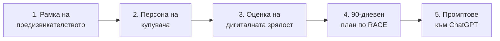

# Шаблони за попълване

## Цели на урока

След този проект ученикът може да:

* формулира маркетингов проблем като въпрос „Как бихме могли…“;
* изгради персона на купувача (buyer persona) върху реални данни, а не върху предположения;
* оцени дигиталната зрялост на бизнес и на конкурентите му по скала от 1 до 5;
* състави 90-дневен маркетингов план по RACE с цели, стратегия, действия и бюджет в евро;
* използва ChatGPT като помощник и проверява всичко, което звучи като факт.

## 1. Как работи проектът

Пет шаблона, които попълваш поред. Всеки следващ стъпва на предишния. Накрая имаш план, който можеш да покажеш на истински собственик на бизнес.

Свали шаблона и го попълни на компютъра или го разпечатай и попълни на ръка.

## 2. Избери вариант

| | Вариант А: съществуваща компания | Вариант Б: нова (несъществуваща) компания |
|---|---|---|
| **За кого работиш** | Реален български бизнес със сайт или активни профили | Бизнес, който ти измисляш |
| **Откъде са данните** | Отзиви в Google, коментари, Meta Ad Library (библиотека с реклами на Meta), разговор с 3 клиенти | Интервюта с поне 5 потенциални клиенти и анализ на двама реални конкуренти |
| **Оценка на зрялостта** | Компанията днес и цел за 12 месеца | Двама конкуренти и нивото, от което стартираш |
| **90-дневният план е за** | Подобрение на това, което съществува | Старт на марката |
| **Най-голямата трудност** | Да видиш проблем, който самата компания не вижда | Да не измисляш „данни“ |

> Опитай сам: ако не можеш да избереш, напиши по едно изречение за двата варианта. Кое те кара да искаш да започнеш веднага? Това е твоят вариант.

## 3. Задание

| Файл | Word | PDF |
|---|:---:|:---:|
| **Задание:** двата варианта, ред на работа, критерии за оценка | [свали](shabloni/00_Zadanie_proekt_shabloni.docx) | [свали](shabloni/00_Zadanie_proekt_shabloni.pdf) |

## 4. Петте шаблона

Това са оригиналните шаблони на Smart Insights и IDEO.org, преведени на български, със запазен дизайн и съдържание. Шаблони 1, 2 и 4 имат полета, които се попълват направо в PDF (в Chrome, Edge или Adobe Acrobat Reader). Шаблон 3 се разпечатва и се попълва на ръка: оградете нивото във всеки ред с различен цвят за компанията и за конкурентите.

| № | Шаблон | Към модул | Попълване | PDF |
|:---:|---|:---:|:---:|:---:|
| 1 | **Рамкирай своето дизайн предизвикателство** (Frame Your Design Challenge), IDEO.org Design Kit | 04 | на компютър | [свали](shabloni/01_Ramka_na_predizvikatelstvoto_DesignKit.pdf) |
| 2 | **Шаблон и чеклист за маркетингова персона на купувача**, Smart Insights | 02, 06 | на компютър | [свали](shabloni/02_Persona_shablon_i_cheklist_SmartInsights.pdf) |
| 3 | **Шаблони за сравнителна оценка на дигиталната маркетингова зрялост**, Smart Insights | 02, 11 | разпечатай | [свали](shabloni/03_Ocenka_na_digitalnata_zrelost_SmartInsights.pdf) |
| 4 | **Шаблон за дигитален маркетингов план по RACE**, Smart Insights | 04 | на компютър | [свали](shabloni/04_RACE_90_dneven_plan_SmartInsights.pdf) |
| 5 | **Примери за промптове към ChatGPT и наръчник за маркетолози**, Smart Insights | 12 | онлайн таблица | [свали](shabloni/05_ChatGPT_promptove_SmartInsights.pdf) |

## 5. Как се оценява

| Критерий | Точки |
|---|:---:|
| Ясно формулиран проблем | 15 |
| Персона, базирана на данни | 20 |
| Честна оценка на зрялостта | 15 |
| 90-дневен план | 30 |
| Работа с AI | 10 |
| Презентация | 10 |

| Точки (от 100) | Оценка |
|:---:|---|
| 90 до 100 | Отличен 6 |
| 75 до 89 | Много добър 5 |
| 60 до 74 | Добър 4 |
| 45 до 59 | Среден 3 |
| под 45 | Слаб 2 |

## Въпроси за дискусия

* Кое е по-трудно: да намериш проблем на съществуваща компания или да докажеш, че проблемът на новата ти компания е реален?
* Защо персона без източници е по-опасна от липсата на персона?
* Кое действие от плана ти би свършил/а още тази седмица, без бюджет?

## Ключови термини

| Термин | Превод |
|---|---|
| Design challenge | дизайн предизвикателство, добре формулиран проблем |
| How Might We (HMW) | „Как бихме могли…“ |
| Buyer persona | персона на купувача |
| Customer journey | клиентски път |
| Benchmarking | сравнителна оценка |
| Digital maturity | дигитална зрялост |
| RACE: Reach, Act, Convert, Engage | достигане, взаимодействие, покупка, лоялност |
| OSA: Opportunity, Strategy, Action | възможност, стратегия, действие |
| SMART objectives | конкретни, измерими, постижими, свързани и срочни цели |
| Conversion rate | коефициент на реализация |
| Prompt | промпт, инструкция към AI |

## Източници

Шаблоните са превод на български от Кирилка Ангелова. Дизайнът и съдържанието на оригиналите са запазени. Правата върху оригиналите остават на авторите им.

| Шаблон | Оригинал | Източник |
|---|---|---|
| 1 | Frame Your Design Challenge, Method Worksheet | IDEO.org, [Design Kit](https://www.designkit.org/methods) |
| 2 | Marketing buyer persona template and checklist, Amelia Cooper | [Smart Insights](https://www.smartinsights.com/membership/free-resources/) |
| 3 | Digital marketing maturity benchmarking templates, Dave Chaffey и Amelia Cooper | [Smart Insights](https://www.smartinsights.com/membership/free-resources/) |
| 4 | RACE Growth System, Digital marketing plan template, Dave Chaffey и Stuart Miller | [Smart Insights](https://www.smartinsights.com/digital-marketing-strategy/race-a-practical-framework-to-improve-your-digital-marketing/) |
| 5 | ChatGPT prompt examples and cheatsheet for marketers | [Smart Insights](https://www.smartinsights.com/membership/free-resources/) |

Заданието с двата варианта: Кирилка Ангелова, CC BY-NC-SA 4.0.
